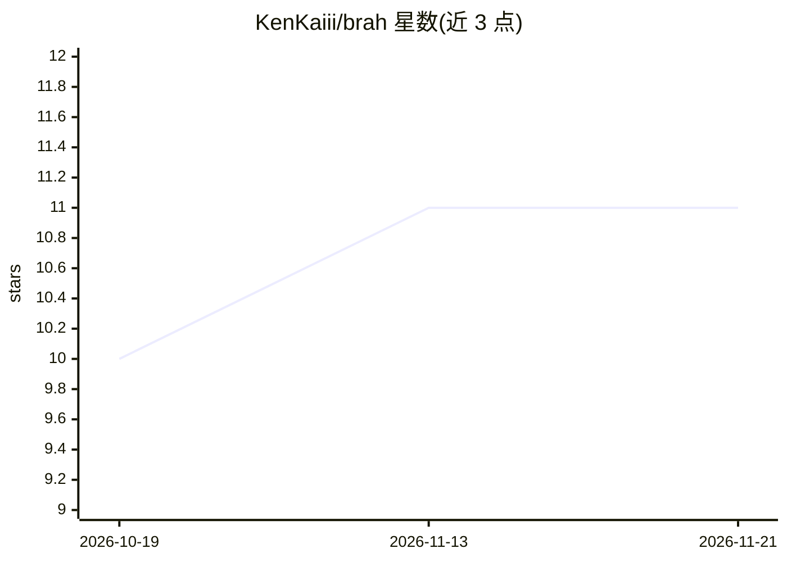

# KenKaiii/brah

⭐ 11 · JavaScript · MIT · 推送 2026-11-19 · [GitHub](https://github.com/KenKaiii/brah) · [官网](https://www.kenkais.com) · 个人维护

**实时桌面语音助手：看屏幕、控电脑、免手动完成任务**

基于 Electron 的桌面语音助手，常驻屏幕一角。通过 OpenAI Realtime API 实现低延迟语音交互、实时转录与可打断对话；截屏交由模型分析屏幕内容，并提供两种 computer use 模式：Playwright 沙盒浏览器与 nut.js 的 OS 级鼠标键盘控制。附带可创建、更新、提醒的任务与日历，以及网络搜索与网页读取。数据本地存储，凭据经系统钥匙串加密，无遥测。需在应用内登录 OpenAI 账户方可启动 Realtime 会话。

## 筛选速览

| 维度 | 判定 | 备注 |
|---|---|---|
| AI 角色 | `ai-native` | 本体是模型或模型工具 |
| 许可风险 | `permissive` | MIT |
| 部署形态 | `library` | 以包/库形式分发 |
| 模型依赖 | — | README 未给出锁定关系 |
| 硬件要求 | — | 无带数字的原话,不猜 |
| 安装摩擦 | `low` | 无编译、无系统依赖或容器化 |
| 成熟度 | — | 结构信号不足 |

## 能力要点

- OpenAI Realtime API 低延迟语音对话与实时转录
- 截屏后由模型分析可见文本、UI 元素与下一步操作
- Browser mode（Playwright）与 OS mode（nut.js）两种控制方式
- 内置任务与日历，agent 可创建、更新并提醒

## 适用场景

- 免手动让语音助手替我操作电脑完成网页任务
- 对话式管理任务清单与日历提醒
- 语音驱动浏览器自动化采集与读取网页信息

## 场景标签

`语音 Agent` `AI 助手` `GUI 自动化` `浏览器自动化` · 领域:效率与自动化

## 证据(README 行号)

> L11: **Brah** is a desktop voice assistant that lives in the corner of your screen. Talk to it and it listens, looks at 
> L34: Two modes:

## 星数曲线

2026-10-19 10 → 2026-11-21 11（+1）

---
*卡片 v1 · prompt 1.4 · 生成 2026-11-19 · 置信度 high · 依据 README sha `d262ccf1e592` · [字段定义](../../DATASET.md)*
