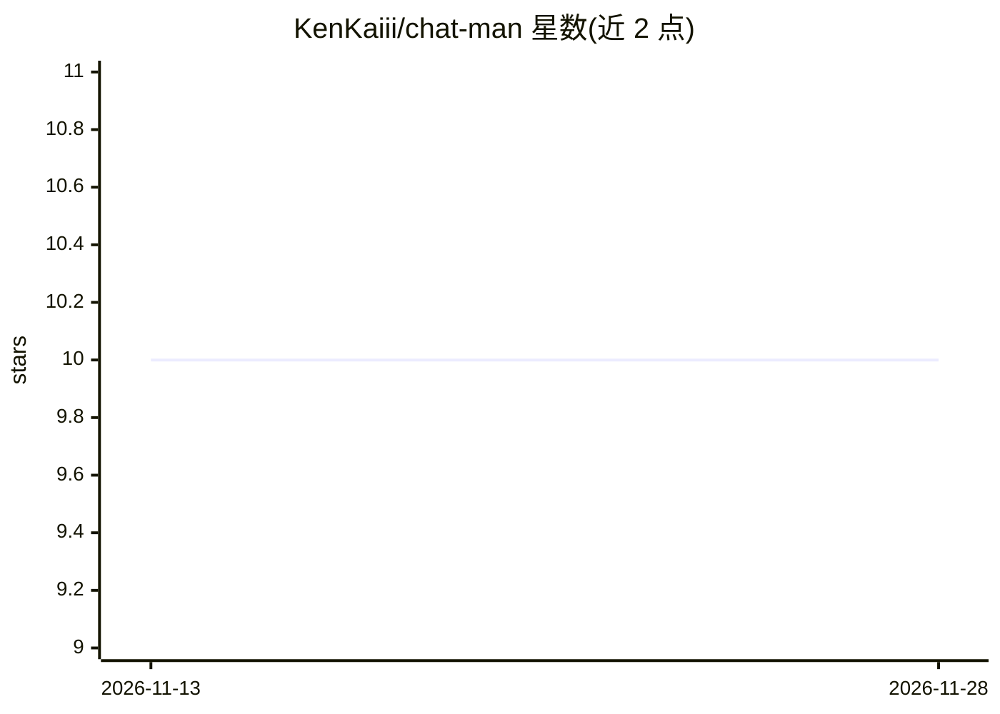

# KenKaiii/chat-man

⭐ 10 · TypeScript · 推送 2026-11-19 · [GitHub](https://github.com/KenKaiii/chat-man) · [官网](https://www.kenkais.com) · 个人维护

**本地优先的隐私 AI 聊天应用：数据不出本机**

基于 Bun 运行的本地 AI 聊天应用，通过 Ollama 在本机运行 Llama、Qwen、Mistral 等模型，无云端依赖与 API key；聊天支持流式输出、Markdown、Mermaid 渲染与文件附件，内置基于 LanceDB 的 RAG 文档检索，并提供 AES-256-GCM 加密、审计日志、会话超时等安全控制，声称支持 GDPR/HIPAA/CCPA 合规并附法律免责声明，合规责任由用户自行承担。平台支持 macOS、Linux、WSL，不支持原生 Windows。

## 筛选速览

| 维度 | 判定 | 备注 |
|---|---|---|
| AI 角色 | `ai-native` | 本体是模型或模型工具 |
| 许可风险 | `none` | — |
| 部署形态 | `None` |  |
| 模型依赖 | local-ok | 支持本地模型 |
| 硬件要求 | — | 无带数字的原话,不猜 |
| 安装摩擦 | `low` | 无编译、无系统依赖或容器化 |
| 成熟度 | — | 结构信号不足 |

## 能力要点

- 100% 本地处理，Ollama 后端，无需云端与 API key
- UI 内直接下载模型，支持 Llama/Qwen/Mistral 等
- 基于 LanceDB 的 RAG 文档上传与检索
- AES-256-GCM 加密、审计日志、会话超时等合规控制

## 适用场景

- 在本机与本地模型对话，数据不离开设备
- 上传文档做本地 RAG 问答
- 处理受监管数据的机构内部署 AI 聊天

## 场景标签

`聊天机器人` `文档问答` · 领域:对话与助手

## 证据(README 行号)

> L5: **Chat with AI models running entirely on your machine. Your data never leaves your computer.**
> L70: - 100% local processing with Ollama

## 星数曲线

2026-11-13 10 → 2026-11-28 10（+0）

---
*卡片 v1 · prompt 1.4 · 生成 2026-11-20 · 置信度 high · 依据 README sha `5d9e0d0af33b` · [字段定义](../../DATASET.md)*
