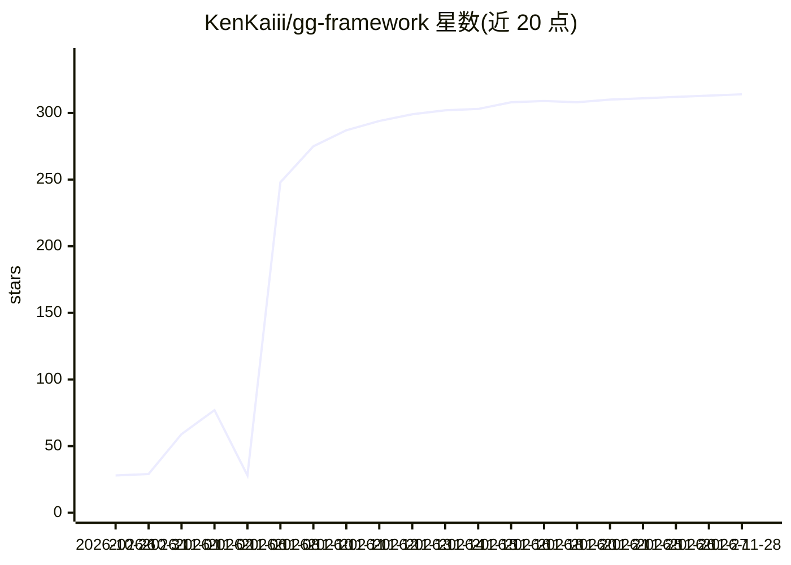

# KenKaiii/gg-framework

⭐ 314 · TypeScript · AGPL-3.0 · 推送 2026-11-27 · [GitHub](https://github.com/KenKaiii/gg-framework) · [官网](https://www.kenkais.com) · 个人维护

**复用已有 AI 订阅的桌面编程 Agent 与框架**

桌面端编程 Agent，通过接入用户已有的 AI 订阅（Claude、ChatGPT、Kimi Code、MiniMax、MiMo）或任意 API key、本地模型来执行编码任务；包含 Agent Steroids（本地检索真实开源代码）、Ken Autopilot（任务验证循环）、一键式安全/合规/无障碍检查与项目健康分。另提供 npm 包（gg-ai/gg-agent/gg-core/ggcoder）供在自己的应用中复用引擎。提供 macOS/Windows/Linux 安装包，README 附带与其他 20 个 Agent 的同任务基准对比数据。

## 筛选速览

| 维度 | 判定 | 备注 |
|---|---|---|
| AI 角色 | `ai-ecosystem` | LLM/agent 周边工具 |
| 许可风险 | `viral` | AGPL-3.0 |
| 部署形态 | `desktop` | 安装包/桌面程序 |
| 模型依赖 | — | README 未给出锁定关系 |
| 硬件要求 | — | 无带数字的原话,不猜 |
| 安装摩擦 | `low` | 无编译、无系统依赖或容器化 |
| 成熟度 | — | 结构信号不足 |

## 能力要点

- 支持订阅计划、API key 或本地模型多种接入方式
- Agent Steroids 在本地无限检索真实开源代码
- 一键检查安全、合规、数据安全、无障碍与测试
- 提供 gg-ai/gg-agent/gg-core/ggcoder 四个 npm 包供构建自己的 Agent

## 适用场景

- 用已付费的 AI 订阅驱动编程 Agent 完成编码任务
- 在自己的应用中集成其 Agent 引擎包
- 对项目做安全、合规等一键检查并得到健康评分

## 场景标签

`编码 Agent` `Agent 框架` · 领域:Agent 开发

## 证据(README 行号)

> L19: GG Coder is a desktop coding agent that gets more out of the AI subscription you already pay for.
> L34: - **Your subscriptions.** Claude, ChatGPT, Kimi Code, MiniMax and MiMo plans, any API key, or local models.
> L93: - **@kenkaiiii/gg-ai**: Connect to AI providers and stream responses.

## 星数曲线

2026-10-26 28 → 2026-11-28 314（+286）

---
*卡片 v1 · prompt 1.4 · 生成 2026-11-25 · 置信度 high · 依据 README sha `f2141c85fce5` · [字段定义](../../DATASET.md)*
