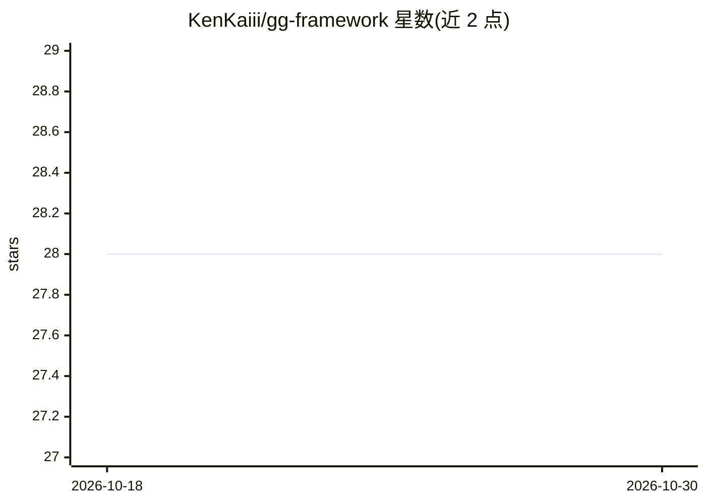

# KenKaiii/gg-framework

⭐ 28 · TypeScript · MIT · 推送 2026-10-28 · [GitHub](https://github.com/KenKaiii/gg-framework) · [官网](https://skool.com/kenkai) · 个人维护

**桌面 AI 编程与聊天应用，支持多模型接入与视频生成**

GG Coder 是面向开发者的桌面 AI 应用（macOS/Windows），提供编程 agent（计划-编辑-测试-验证）、Ken Autopilot 代码审查循环、GG Goals 整体目标交付（可拆分任务给多个并行 worker，支持非代码文件夹）、基于本地开源代码库的 Agent Steroids、带记忆的聊天以及视频生成。接入方式覆盖 Claude/ChatGPT/Gemini/Grok/Kimi 订阅登录、OpenAI/Anthropic/DeepSeek/GLM/MiniMax/OpenRouter 等 API key 及本地模型，支持 MCP 服务器与 Telegram 驱动。同时以 npm 包形式提供框架组件（gg-ai/gg-agent/gg-core/ggcoder）供自建 agent。README 含与其他 19 个编码 agent 的速度与用量对比表格。

## 筛选速览

| 维度 | 判定 | 备注 |
|---|---|---|
| AI 角色 | `ai-native` | 本体是模型或模型工具 |
| 许可风险 | `permissive` | MIT |
| 部署形态 | `desktop` | 安装包/桌面程序 |
| 模型依赖 | locked-api |  |
| 硬件要求 | — | 无带数字的原话,不猜 |
| 安装摩擦 | `low` | 无编译、无系统依赖或容器化 |
| 成熟度 | — | 结构信号不足 |

## 能力要点

- Ken Autopilot 审查编码工作并循环推进至完成
- GG Goals 拆分目标给并行 worker 团队执行，支持非代码文件夹
- 多提供商接入：订阅登录、API key 与本地模型，含用量计量
- 框架组件以 npm 包形式可独立用于自建 agent

## 适用场景

- 让编程 agent 计划、编辑并运行我的测试
- 把一个整体目标交给应用并行完成（代码、文档、研究）
- 在同一桌面应用里切换多家 AI 提供商做编码与聊天

## 场景标签

`编码 Agent` `代码审查` `视频生成` · 领域:编码与开发

## 证据(README 行号)

> L24: GG Coder is a desktop AI app for coding, chatting, running whole goals and making videos. Pick your AI provider, op
> L59: - **Code:** a coding agent that plans, edits, runs your tests and tells you straight what it verified. Plan mode le
> L65: - **Your models, your way:** sign in with Claude, ChatGPT, Gemini, Grok or Kimi subscriptions, use API keys for Ope

## 星数曲线

2026-10-18 28 → 2026-10-30 28（+0）

---
*卡片 v1 · prompt 1.4 · 生成 2026-10-26 · 置信度 high · 依据 README sha `6293b9d237bb` · [字段定义](../../DATASET.md)*
