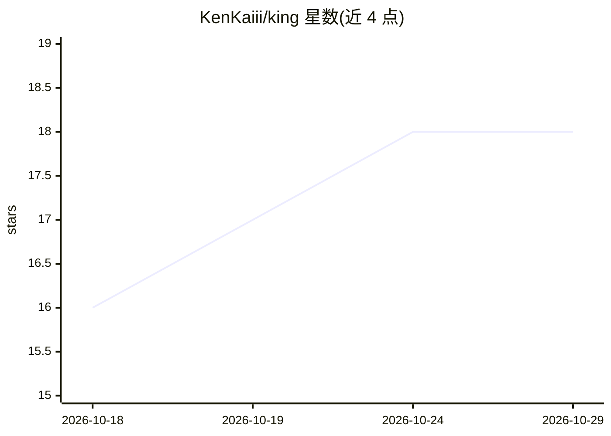

# KenKaiii/king

⭐ 18 · TypeScript · AGPL-3.0 · 推送 2026-05-18 · [GitHub](https://github.com/KenKaiii/king) · [官网](https://youtube.com/@kenkaidoesai) · 个人维护

**电商卖家的桌面创作工具：生成产品图并管理店铺与广告**

面向电商卖家的 Mac/Windows 桌面应用，基于 Electron + React 构建。核心功能：以卖家自己的产品参考图生成不同角度与场景的产品图（调用 fal.ai 的 nano-banana-2 / nano-banana-2/edit 模型）、160+ 分类提示词库、产品与人物素材库、以及 Shopify/Amazon/Shopee 数据接入和 Facebook Ads、Google Ads、TikTok Shop 仪表盘。数据存储在本机，API key 存于系统钥匙串。需自备 fal.ai API key，图像生成调用云端。

## 筛选速览

| 维度 | 判定 | 备注 |
|---|---|---|
| AI 角色 | `ai-native` | 本体是模型或模型工具 |
| 许可风险 | `viral` | AGPL-3.0 |
| 部署形态 | `library` | 以包/库形式分发 |
| 模型依赖 | — | README 未给出锁定关系 |
| 硬件要求 | — | 无带数字的原话,不猜 |
| 安装摩擦 | `low` | 无编译、无系统依赖或容器化 |
| 成熟度 | — | 结构信号不足 |

## 能力要点

- 基于参考图生成多角度/多比例产品图（7 种宽高比）
- 160+ 提示词库，11 个品类，按使用频率排序
- 产品/人物素材库与 API key 钥匙串管理
- 内置 Facebook Ads、Google Ads、TikTok Shop、Shopee 仪表盘

## 适用场景

- 电商卖家批量生成各平台规格的产品图与广告素材
- 统一管理产品素材、提示词与店铺/广告账号
- 用同一人物形象规模化生成一致性产品图

## 场景标签

`图像生成` · 领域:内容生成

## 证据(README 行号)

> L36: Upload your actual product. King uses it as visual reference and generates new shots — different angles, scenes, li
> L38: Runs on fal.ai's nano-banana-2 and nano-banana-2/edit. Fast, sharp, actually looks like your product.
> L100: - Image generation calls go to fal.ai (that's how it works)

## 星数曲线

2026-10-18 16 → 2026-10-29 18（+2）

---
*卡片 v1 · prompt 1.4 · 生成 2026-10-29 · 置信度 high · 依据 README sha `c6f271cef9a5` · [字段定义](../../DATASET.md)*
