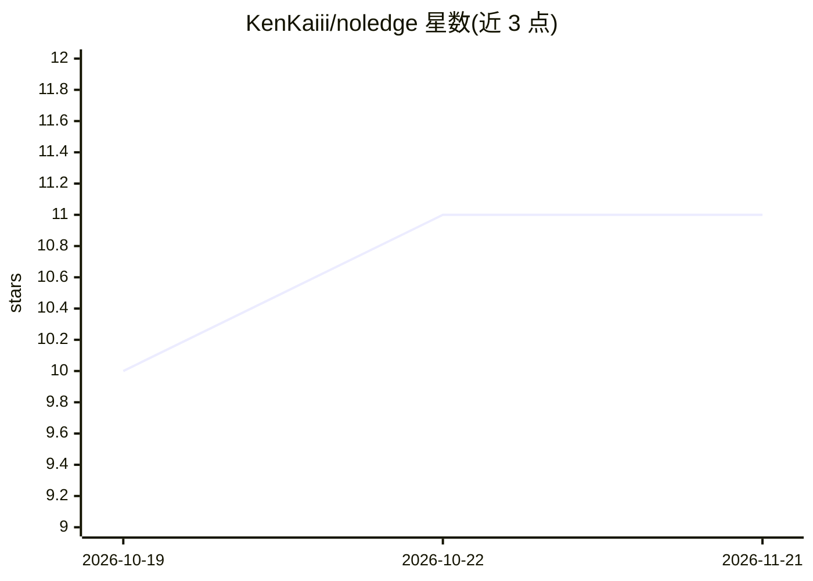

# KenKaiii/noledge

⭐ 11 · TypeScript · MIT · 推送 2026-11-19 · [GitHub](https://github.com/KenKaiii/noledge) · [官网](https://www.kenkais.com) · 个人维护

**本地运行的第二大脑：导入文档视频后直接问答**

一个本地运行的个人知识库问答应用：导入 PDF、Word、网页文章、YouTube 视频等资料后，通过 RAG 机制先检索个人文件中的相关片段，再交由 LLM 生成带出处的回答。支持图片文字读取、YouTube 字幕抓取、订阅博客/频道自动收录，以及 3D 知识图谱可视化。数据存于本地单文件，需 Node.js 环境以 npm 安装并运行，需在设置中填入模型 API key（OpenAI key 驱动记忆部分，其余可选）。

## 筛选速览

| 维度 | 判定 | 备注 |
|---|---|---|
| AI 角色 | `ai-native` | 本体是模型或模型工具 |
| 许可风险 | `permissive` | MIT |
| 部署形态 | `library` | 以包/库形式分发 |
| 模型依赖 | locked-api |  |
| 硬件要求 | — | 无带数字的原话,不猜 |
| 安装摩擦 | `low` | 无编译、无系统依赖或容器化 |
| 成熟度 | — | 结构信号不足 |

## 能力要点

- RAG 问答：回答引用本地文件片段并标注出处
- 支持 PDF/Word/网页/YouTube/截图等多源导入
- 可订阅博客、YouTube 频道、研究 feed 自动拉取新内容
- 数据存本地单文件，无云账号
- 多提供商接入：OpenAI、Anthropic/Claude、Gemini、DeepSeek 等

## 适用场景

- 把收藏的文章、视频、PDF 统一存入并直接提问
- 问答时追溯答案出自哪份个人资料
- 自动跟踪关注的博客和频道持续扩充知识库

## 场景标签

`文档问答` `知识库管理` `知识图谱` · 领域:知识与检索

## 证据(README 行号)

> L18: **Noledge** is a place to dump everything you read, watch, and save, then just *talk to it* like a friend who actua
> L42: Noledge does it differently. When you ask a question, it first goes and **finds the exact bits from your own files 
> L67: Works with all the big AI providers (OpenAI, Anthropic/Claude, Google Gemini, DeepSeek, and more). Use whichever on

## 星数曲线

2026-10-19 10 → 2026-11-21 11（+1）

---
*卡片 v1 · prompt 1.4 · 生成 2026-11-19 · 置信度 high · 依据 README sha `b275292a4f57` · [字段定义](../../DATASET.md)*
