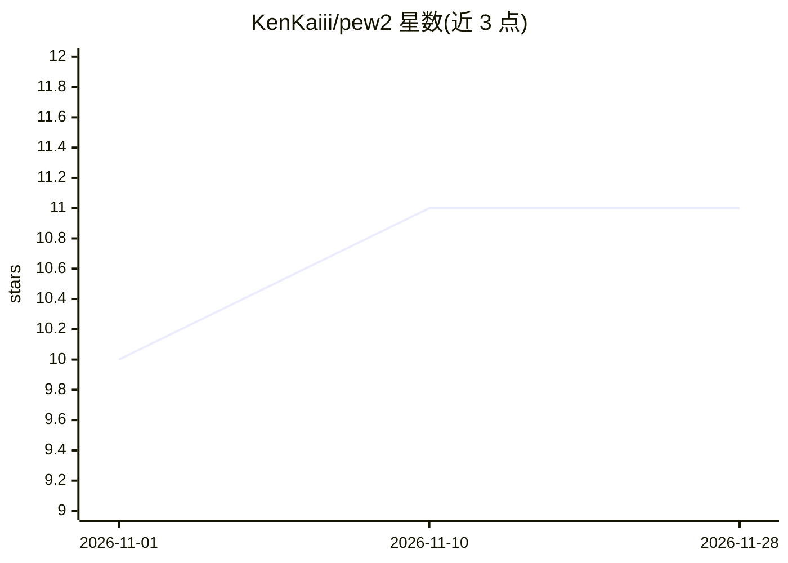

# KenKaiii/pew2

⭐ 11 · TypeScript · AGPL-3.0 · 推送 2026-11-27 · [GitHub](https://github.com/KenKaiii/pew2) · [官网](https://www.kenkais.com) · 个人维护

**用手机远程对话与审批本机编程 agent 的客户端**

pew2 由手机 App 和电脑端守护进程两部分组成：电脑上运行一条安装脚本，自动发现已安装的编程 agent（Claude Code、Codex、Gemini CLI 等），后台启动服务并生成二维码完成配对。手机端可查看会话、切换模型、批准或拒绝文件写入/命令执行请求、发送语音与截图，长任务完成时推送通知。通信经 QR 密钥端到端加密，外网通过自部署的 Cloudflare Worker 中继。本身不含 AI，仅通过 ACP 协议驱动本机已有 agent。

## 筛选速览

| 维度 | 判定 | 备注 |
|---|---|---|
| AI 角色 | `ai-ecosystem` | LLM/agent 周边工具 |
| 许可风险 | `viral` | AGPL-3.0 |
| 部署形态 | `library` | 以包/库形式分发 |
| 模型依赖 | — | README 未给出锁定关系 |
| 硬件要求 | — | 无带数字的原话,不猜 |
| 安装摩擦 | `low` | 无编译、无系统依赖或容器化 |
| 成熟度 | — | 结构信号不足 |

## 能力要点

- 自动发现本机已装编程 agent，支持 ACP 协议，新增 agent 只需一个 JSON 清单
- 手机端远程审批文件写入与命令执行请求
- QR 密钥端到端加密，中继为用户自部署的 Cloudflare Worker
- 支持语音输入、图片/截图发送与任务完成推送通知

## 适用场景

- 离开电脑后用手机查看和继续编程 agent 会话
- 远程批准 agent 的文件写入或命令执行
- 在外网环境通过自部署中继连接家中电脑

## 场景标签

`编码 Agent` · 领域:编码与开发

## 证据(README 行号)

> L77: pew2 does not include an AI. It drives the agents already installed on your
> L189: again without losing a conversation. Agents are spoken to over

## 星数曲线

2026-11-01 10 → 2026-11-28 11（+1）

---
*卡片 v1 · prompt 1.4 · 生成 2026-11-19 · 置信度 mid · 依据 README sha `dab72776ae88` · [字段定义](../../DATASET.md)*
