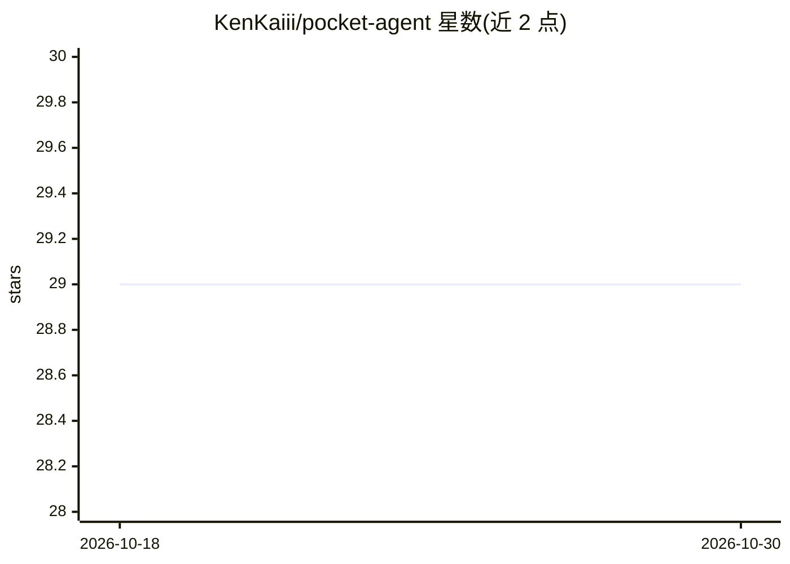

# KenKaiii/pocket-agent

⭐ 29 · TypeScript · MIT · 推送 2026-08-28 · [GitHub](https://github.com/KenKaiii/pocket-agent) · [官网](https://www.youtube.com/kenkaidoesai) · 个人维护

**常驻菜单栏的个人 AI 助手，带持久记忆与自动化例程**

基于 Electron + Claude Agent SDK + SQLite + TypeScript 构建的 macOS 菜单栏个人 AI 助手：持续抽取并组织用户事实（项目、人物、偏好）供语义检索，提供定时执行的 Routines 自动化、隐藏窗口/接管 Chrome 两种浏览器自动化模式、最多 5 个隔离会话、Telegram 接入、内置任务与日历管理，以及 40+ 技能集成（Notion/GitHub/Slack 等）与 MCP 服务器支持。数据本地 SQLite 存储，对话经 Anthropic API 处理。安装方式为下载 macOS 安装包（Apple Silicon/Intel）或源码运行，需自备 Anthropic API key，仅支持 macOS。

## 筛选速览

| 维度 | 判定 | 备注 |
|---|---|---|
| AI 角色 | `ai-native` | 本体是模型或模型工具 |
| 许可风险 | `permissive` | MIT |
| 部署形态 | `library` | 以包/库形式分发 |
| 模型依赖 | locked-api |  |
| 硬件要求 | — | 无带数字的原话,不猜 |
| 安装摩擦 | `low` | 无编译、无系统依赖或容器化 |
| 成熟度 | — | 结构信号不足 |

## 能力要点

- 持久记忆系统：抽取并组织用户事实，支持语义检索历史信息
- 定时 Routines：带工具与浏览器自动化的完整 agent 执行
- 浏览器自动化两模式：隐藏 Electron 窗口 / 接管已登录 Chrome 会话
- 40+ 技能集成与 MCP 服务器支持，最多 5 个隔离会话

## 适用场景

- 让桌面常驻助手记住我的偏好与项目上下文，随时对话
- 设置每日例程自动汇总日历、Slack 并生成简报
- 通过 Telegram 在手机端继续使用同一记忆与工具
- 自动化需要登录态的网页操作（表单填写、数据抓取）

## 场景标签

`AI 助手` `浏览器自动化` `Agent 记忆` · 领域:Agent 开发

## 证据(README 行号)

> L12: **Pocket Agent** is a personal AI that lives in your menu bar 24/7. It remembers everything, learns who you are, an
> L137: Stack: Electron + Claude Agent SDK + SQLite + TypeScript

## 星数曲线

2026-10-18 29 → 2026-10-30 29（+0）

---
*卡片 v1 · prompt 1.4 · 生成 2026-10-26 · 置信度 high · 依据 README sha `df2c4534927e` · [字段定义](../../DATASET.md)*
