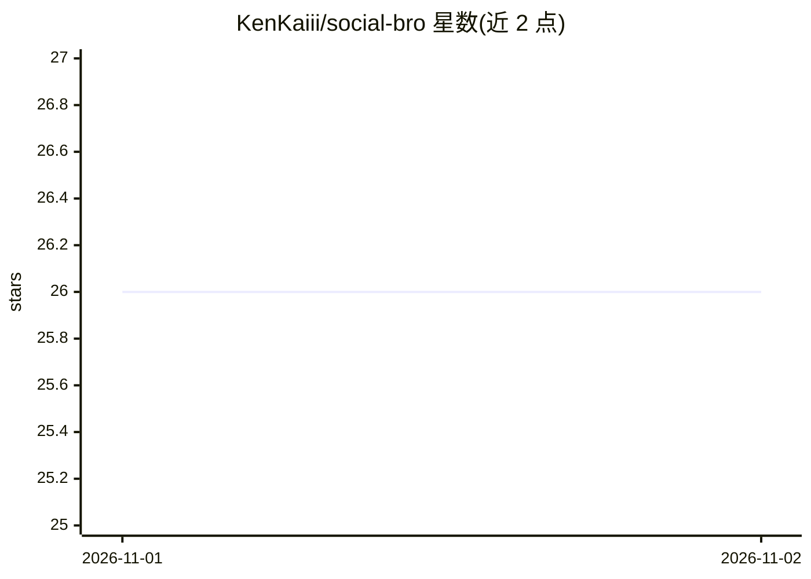

# KenKaiii/social-bro

⭐ 26 · TypeScript · 推送 2026-08-21 · [GitHub](https://github.com/KenKaiii/social-bro) · 个人维护

**跨平台搜索 YouTube/TikTok/Instagram 的内容二创工具**

基于 Next.js 的 Web 应用：统一搜索 YouTube、TikTok 与 Instagram 内容，可按 @creator 过滤；支持抓取 YouTube 字幕并用 AI 生成面向其他平台的精简版本，另提供 AI 开场钩子生成与搜索历史保存。面向内容创作者，需 Node.js 18+ 与 Docker，通过 git clone 源码部署，MIT 许可。

## 筛选速览

| 维度 | 判定 | 备注 |
|---|---|---|
| AI 角色 | `ai-native` | 本体是模型或模型工具 |
| 许可风险 | `none` | — |
| 部署形态 | `None` |  |
| 模型依赖 | — | README 未给出锁定关系 |
| 硬件要求 | — | 无带数字的原话,不猜 |
| 安装摩擦 | `low` | 无编译、无系统依赖或容器化 |
| 成熟度 | — | 结构信号不足 |

## 能力要点

- 三平台统一搜索并支持 @creator 过滤
- 提取 YouTube 字幕并生成跨平台精简版本
- AI 生成开场钩子
- 搜索历史保存与回访

## 适用场景

- 在一个入口同时搜索三个平台的内容选题
- 把 YouTube 视频脚本改编成其他平台的短内容
- 为视频生成开场钩子文案

## 场景标签

`AI 写作` · 领域:内容生成

## 证据(README 行号)

> L8: - **Content Repurposing** - Extract YouTube transcripts and generate shorter versions for other platforms
> L9: - **Hook Generator** - AI-powered opening lines to grab attention

## 星数曲线

2026-11-01 26 → 2026-11-02 26（+0）

---
*卡片 v1 · prompt 1.4 · 生成 2026-10-31 · 置信度 high · 依据 README sha `62cf7adc629a` · [字段定义](../../DATASET.md)*
