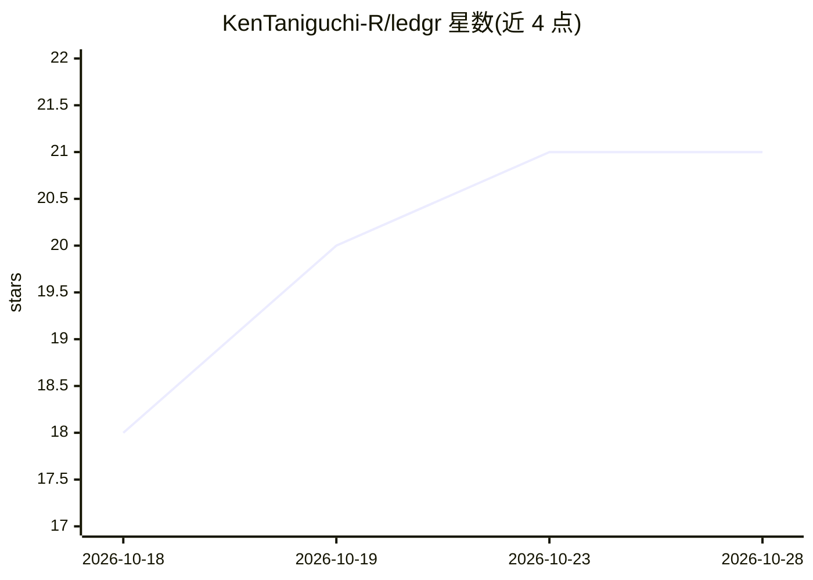

# KenTaniguchi-R/ledgr

⭐ 21 · TypeScript · AGPL-3.0 · 推送 2026-10-14 · [GitHub](https://github.com/KenTaniguchi-R/ledgr) · 个人维护

**自托管个人记账应用：银行同步+AI分类+MCP代理查询**

基于 Next.js/TypeScript 的自托管个人理财应用（AGPL-3.0），通过 Plaid（12,000+ 银行）或 SimpleFIN 自动同步交易，四级流水线分类（用户规则>商家默认>Plaid分类>AI兜底），提供预算、投资追踪、订阅识别与财务报表，数据存于自有服务器的 PostgreSQL。内置 MCP 服务器，Claude Code、Cursor 等 MCP 客户端可经 OAuth 授权用 18 个工具查询和操作财务数据；AI 聊天与分类为 BYOK（自带 OpenAI/Anthropic/Google/Openrouter 或本地模型 API key）。需 Docker Compose 部署；加密密钥丢失将导致 Plaid 令牌等数据不可恢复。

## 筛选速览

| 维度 | 判定 | 备注 |
|---|---|---|
| AI 角色 | `ai-enhanced` | 去掉 AI 部分产品仍成立 |
| 许可风险 | `viral` | AGPL-3.0 |
| 部署形态 | `self-host` | docker 或自建部署 |
| 模型依赖 | — | README 未给出锁定关系 |
| 硬件要求 | — | 无带数字的原话,不猜 |
| 安装摩擦 | `low` | 无编译、无系统依赖或容器化 |
| 成熟度 | — | 结构信号不足 |

## 能力要点

- Plaid/SimpleFIN 自动银行同步，CSV/OFX/QFX 导入兜底
- 内置 MCP 服务器，18 个读写/同步工具按 OAuth scope 分权
- 四级智能分类管道，AI 兜底采用 BYOK 自带 key
- 预算/投资/订阅检测/净资产报表全自托管

## 适用场景

- 在自己服务器上管理银行账户、预算与投资组合
- 通过 Claude Code 等 MCP 客户端用自然语言查询财务
- 自动同步并分类交易、识别订阅类固定支出

## 场景标签

 · 领域:个人理财/自托管应用

## 证据(README 行号)

> L15: Ledgr connects to your bank accounts through Plaid or SimpleFIN, automatically syncs and categorizes transactions, 
> L36: - **AI agent interface (MCP)** — query your finances from Claude Code, Claude Desktop, Cursor, or any MCP client

## 星数曲线

2026-10-18 18 → 2026-10-28 21（+3）

---
*卡片 v1 · prompt 1.4 · 生成 2026-10-28 · 置信度 mid · 依据 README sha `8c452ecae4b6` · [字段定义](../../DATASET.md)*
