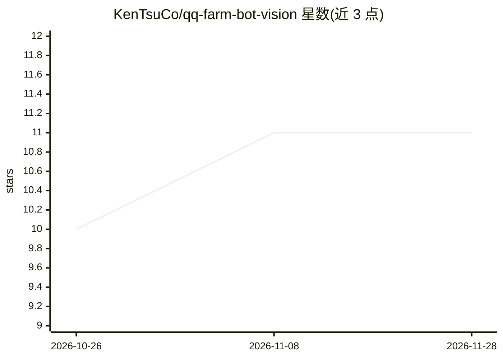

# KenTsuCo/qq-farm-bot-vision

⭐ 11 · Python · MIT · 推送 2026-10-14 · [GitHub](https://github.com/KenTsuCo/qq-farm-bot-vision) · 个人维护 · 中文 README

**QQ经典农场玩家：CV视觉自动收菜/除草/偷菜机器人**

基于计算机视觉模板匹配的QQ农场自动化机器人，通过识别游戏窗口图标并控制鼠标点击实现自动收菜、除草/除虫/浇水、种植、偷菜、帮忙照料和领取每日化肥等功能。运行需Windows 10+、Python ≥3.9与NT架构桌面版QQ，游戏窗口须保持前台。当前为早期测试版本（Alpha），仅提供源码启动方式，图像匹配需自行调整阈值参数，后续计划引入YOLO目标检测模型。

## 筛选速览

| 维度 | 判定 | 备注 |
|---|---|---|
| AI 角色 | `ai-native` | 本体是模型或模型工具 |
| 许可风险 | `permissive` | MIT |
| 部署形态 | `library` | 以包/库形式分发 |
| 模型依赖 | — | README 未给出锁定关系 |
| 硬件要求 | — | 无带数字的原话,不猜 |
| 安装摩擦 | `low` | 无编译、无系统依赖或容器化 |
| 成熟度 | `idea` | |

## 能力要点

- CV图像模板匹配识别游戏图标并自动控制鼠标操作
- 自动收菜、除草/除虫/浇水、种植、偷菜、领化肥等功能
- 初版GUI界面与快捷键控制（暂停/恢复/退出）
- 规划基于YOLO神经网络训练目标检测模型提升识别精度

## 适用场景

- 自动完成QQ农场日常收菜、除草、浇水操作
- 自动偷取好友农场作物
- 研究学习AI视觉技术在游戏自动化中的应用

## 场景标签

`GUI 自动化` · 领域:效率与自动化

## 证据(README 行号)

> L2: # QQ经典农场机器人（AI视觉版本）
> L14: - 当前版本已实现`自动收菜`、`自动除草/除虫/浇水`、`自动种植（测试中）`、`自动偷菜`、`自动帮忙除草/除虫/浇水`、`自动领取每日免费化肥` 功能，相关功能在不断测试优化中
> L41: - 基于yolo神经网络训练目标检测模型

## 星数曲线

2026-10-26 10 → 2026-11-28 11（+1）

---
*卡片 v1 · prompt 1.4 · 生成 2026-11-19 · 置信度 high · 依据 README sha `6c4009345766` · [字段定义](../../DATASET.md)*
