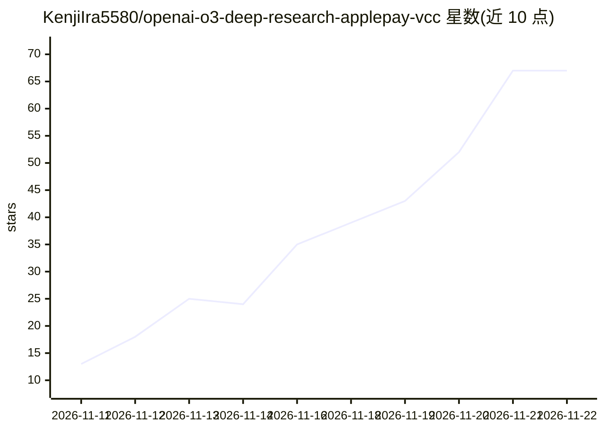

# KenjiIra5580/openai-o3-deep-research-applepay-vcc

⭐ 67 · 推送 2026-11-11 · [GitHub](https://github.com/KenjiIra5580/openai-o3-deep-research-applepay-vcc) · [官网](https://app.coregold.io/signup?invite_code=ADvlj9b) · 个人维护 · 中文 README

**付费推广文：用 CoreGold 虚拟卡开通 OpenAI o3 订阅的教程**

仓库内容为一份图文教程，指导读者注册 CoreGold 虚拟信用卡（VCC）服务，通过 USDT 充值、开卡、挂载 Apple Wallet，完成 ChatGPT Plus/Pro 订阅与 OpenAI API 付款。文中解释 Stripe 风控机制（BIN 核验、AVS、预授权）并对比国内双币卡与该 VCC 服务。无代码、无安装运行方式，仅包含指向 CoreGold 控制台的注册入口链接，属商业推广性质内容。

## 筛选速览

| 维度 | 判定 | 备注 |
|---|---|---|
| AI 角色 | `ai-knowledge` | 知识聚合/清单类 |
| 许可风险 | `none` | — |
| 部署形态 | `None` |  |
| 模型依赖 | — | README 未给出锁定关系 |
| 硬件要求 | — | 无带数字的原话,不猜 |
| 安装摩擦 | `low` | 无编译、无系统依赖或容器化 |
| 成熟度 | — | 结构信号不足 |

## 能力要点

- 步骤化教程：USDT 充值→开通 VCC→挂载 Apple Pay 完成订阅
- 解释 Stripe Radar 风控环节（BIN 国别核验、AVS、Tokenization、预授权）
- 全文无代码或可运行产物，仅含服务注册链接

## 适用场景

- 了解跨境订阅 OpenAI 服务被拒付的风控原因
- 按教程使用 CoreGold VCC 服务完成付款

## 场景标签

 · 领域:跨境支付/商业推广

## 证据(README 行号)

> L2: ⚡ 2026 实战指南：手把手教你用 CoreGold 商业 VCC + Apple Pay 开通 OpenAI o3 / Deep Research
> L4: 随着 OpenAI 全面开放支持多步长链逻辑推演与复杂数理验证的 o3 与 o3-mini 模型，并整合长程全网研报引擎 Deep Research，ChatGPT Plus 与 Pro 权限已成为学术调研、架构设计与算法落地的生产

## 星数曲线

2026-11-11 13 → 2026-11-22 67（+54）

---
*卡片 v1 · prompt 1.4 · 生成 2026-11-18 · 置信度 mid · 依据 README sha `c3fac895f4df` · [字段定义](../../DATASET.md)*
