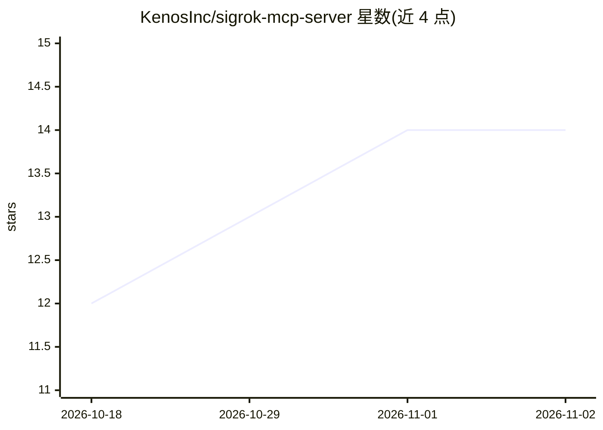

# KenosInc/sigrok-mcp-server

⭐ 14 · Go · MIT · 推送 2026-10-28 · [GitHub](https://github.com/KenosInc/sigrok-mcp-server) · [官网](https://kenosinc.github.io/sigrok-mcp-server/) · 组织维护

**让 Claude/Cursor 等 AI agent 操作逻辑分析仪的 MCP 服务器**

基于 Model Context Protocol 的 sigrok 服务器，封装 sigrok-cli，向 Claude Code、Codex、Cursor 等 agent 提供 11 个工具：扫描设备、采集信号数据、调用 100+ 协议解码器（I2C/SPI/UART/CAN 等）、查询驱动与固件状态。通过 stdio JSON-RPC 通信，不使用 C 绑定，将 sigrok-cli 文本输出解析为 JSON。供嵌入式/硬件调试场景下的开发者配合 MCP 客户端使用；部分硬件需自行挂载固件目录（许可限制不随镜像分发）。

## 筛选速览

| 维度 | 判定 | 备注 |
|---|---|---|
| AI 角色 | `ai-ecosystem` | LLM/agent 周边工具 |
| 许可风险 | `permissive` | MIT |
| 部署形态 | `self-host` | docker 或自建部署 |
| 模型依赖 | — | README 未给出锁定关系 |
| 硬件要求 | — | 无带数字的原话,不猜 |
| 安装摩擦 | `low` | 无编译、无系统依赖或容器化 |
| 成熟度 | — | 结构信号不足 |

## 能力要点

- 封装 sigrok-cli 提供 11 个 MCP 工具（采集、解码、设备扫描等）
- 支持 I2C、SPI、UART、CAN 等 100+ 协议解码
- sigrok-cli 原始输出解析为结构化 JSON
- 提供固件状态检查工具诊断设备识别问题

## 适用场景

- 让 AI agent 自动采集并解码逻辑分析仪信号做硬件调试
- 通过对话完成嵌入式设备通信协议分析
- IoT 设备开发中自动化信号捕获与协议排查

## 场景标签

 · 领域:嵌入式系统/硬件调试工具

## 证据(README 行号)

> L8: A Model Context Protocol (MCP) server for sigrok — enables AI agents like Claude Code, Codex, and Cursor to capture,
> L119: - **No C bindings**: sigrok-cli is the sole interface to sigrok

## 星数曲线

2026-10-18 12 → 2026-11-02 14（+2）

---
*卡片 v1 · prompt 1.4 · 生成 2026-10-31 · 置信度 high · 依据 README sha `2f35bf44b1c0` · [字段定义](../../DATASET.md)*
