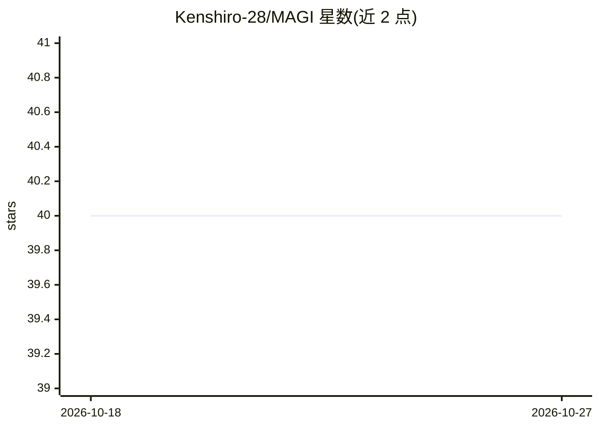

# Kenshiro-28/MAGI

⭐ 40 · Python · GPL-3.0 · 推送 2026-09-25 · [GitHub](https://github.com/Kenshiro-28/MAGI) · 个人维护

**本地开源 LLM 驱动的自主 AI 助手，含工具链与长期记忆**

MAGI 是基于开源大模型（GGUF，经 llama-cpp-python 运行）的对话式 AI 系统，面向消费级硬件本地部署。功能包括可定制的 Core Protocol 推理框架、模块化工具链（Python 代码执行、网页浏览、SDXL 图像生成）、基于嵌入检索的长期记忆 Codex，以及 Telegram 远程操作。提供 Normal/Mission/NERV（多 agent）/MAGI 全自主四种模式，空闲时可自主决定是否继续任务。推荐在 Debian stable 上运行，其他系统用 Docker。上下文窗口默认最小 131072 tokens，推荐模型为 30.2GB 的 Q8_0 量化版本。

## 筛选速览

| 维度 | 判定 | 备注 |
|---|---|---|
| AI 角色 | `ai-native` | 本体是模型或模型工具 |
| 许可风险 | `viral` | GPL-3.0 |
| 部署形态 | `self-host` | docker 或自建部署 |
| 模型依赖 | local-ok | 支持本地模型 |
| 硬件要求 | — | 无带数字的原话,不猜 |
| 安装摩擦 | `low` | 无编译、无系统依赖或容器化 |
| 成熟度 | — | 结构信号不足 |

## 能力要点

- 四种 AI 模式，含 NERV 多 agent 协作与 MAGI 全自主模式
- 长期记忆 Codex：跨会话嵌入检索保存代码片段与研究结论
- 工具链插件：Python 代码执行（隔离虚拟环境、最多 10 轮审查）、网页浏览、SDXL 图像生成
- 空闲时后台思考循环自主决定继续任务或保持沉默

## 适用场景

- 在本地消费级硬件上运行可自主执行任务的 AI 助手
- 通过 Telegram 远程操作获得移动端 AI 支持
- 需要长期记忆与多步代码执行的研究或自动化任务

## 场景标签

`Agent 记忆` `多智能体` `AI 助手` · 领域:Agent 开发

## 证据(README 行号)

> L11: **MAGI (マギ)** is an advanced AI system powered by open-source large language models. It operates through a conversa
> L13: Key features include a customizable Core Protocol for enhanced reasoning, a modular Toolchain for dynamic tool chai

## 星数曲线

2026-10-18 40 → 2026-10-27 40（+0）

---
*卡片 v1 · prompt 1.4 · 生成 2026-10-25 · 置信度 high · 依据 README sha `2fc1911d2df1` · [字段定义](../../DATASET.md)*
