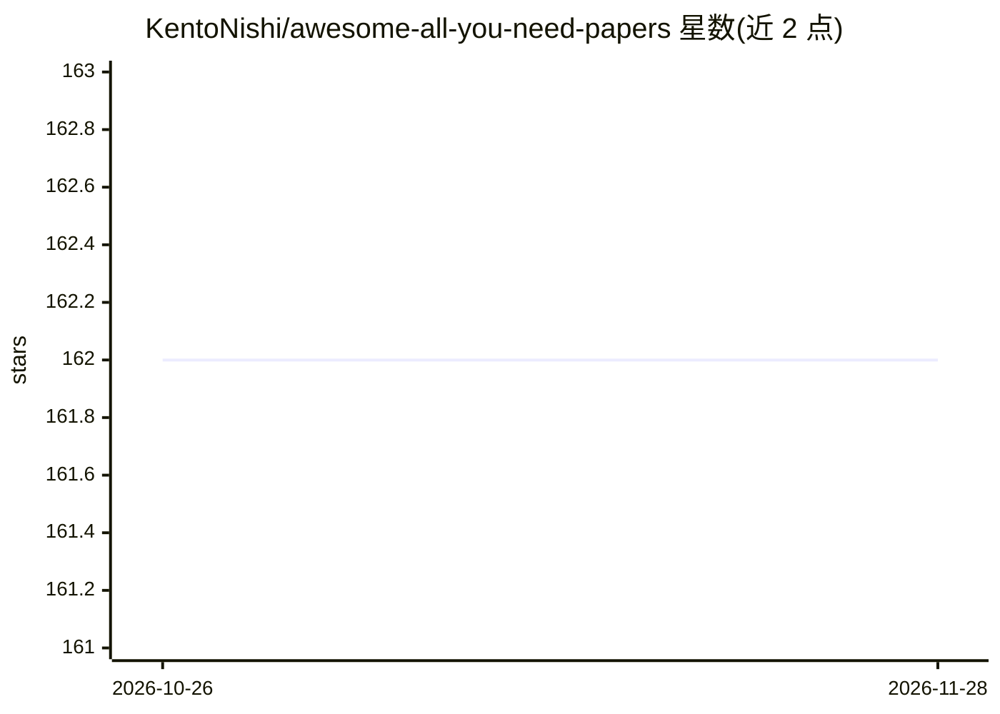

# KentoNishi/awesome-all-you-need-papers

⭐ 162 · Python · 推送 2026-11-26 · [GitHub](https://github.com/KentoNishi/awesome-all-you-need-papers) · [官网](https://kentonishi.github.io/awesome-all-you-need-papers/) · 个人维护

**机器学习研究者：汇集标题含 "all you need" 的论文清单**

以 awesome-list 形式维护的论文清单：收录标题包含 "all you need" 的 arXiv 论文，按表格列出标题、作者与日期，从 2015 年的初始化方法论文到 2021 年底的对抗防御等工作。清单通过 arXiv API 每日自动更新（更新时间由 GitHub Action 定时触发）。内容仅包含论文条目列表，不含安装、运行或 API 接入说明，面向需要检索这一命名系列论文的读者。

## 筛选速览

| 维度 | 判定 | 备注 |
|---|---|---|
| AI 角色 | `ai-knowledge` | 知识聚合/清单类 |
| 许可风险 | `none` | — |
| 部署形态 | `None` |  |
| 模型依赖 | — | README 未给出锁定关系 |
| 硬件要求 | — | 无带数字的原话,不猜 |
| 安装摩擦 | `low` | 无编译、无系统依赖或容器化 |
| 成熟度 | — | 结构信号不足 |

## 能力要点

- 收录标题含 "all you need" 的论文，按标题/作者/日期表格组织
- 通过 arXiv API 每日自动更新清单
- 覆盖 2015-2021 年间的论文条目

## 适用场景

- 查找某篇记不清全名的 "all you need" 系列论文
- 浏览这一命名梗下的机器学习论文列表
- 按日期追踪新收录的相关论文

## 场景标签

`精选清单` · 领域:学习与行业

## 证据(README 行号)

> L8: This repository is a list of all "all you need" papers. The list is updated daily using the arXiv API.
> L10: ## Paper List

## 星数曲线

2026-10-26 162 → 2026-11-28 162（+0）

---
*卡片 v1 · prompt 1.4 · 生成 2026-11-27 · 置信度 high · 依据 README sha `9480b9db829f` · [字段定义](../../DATASET.md)*
