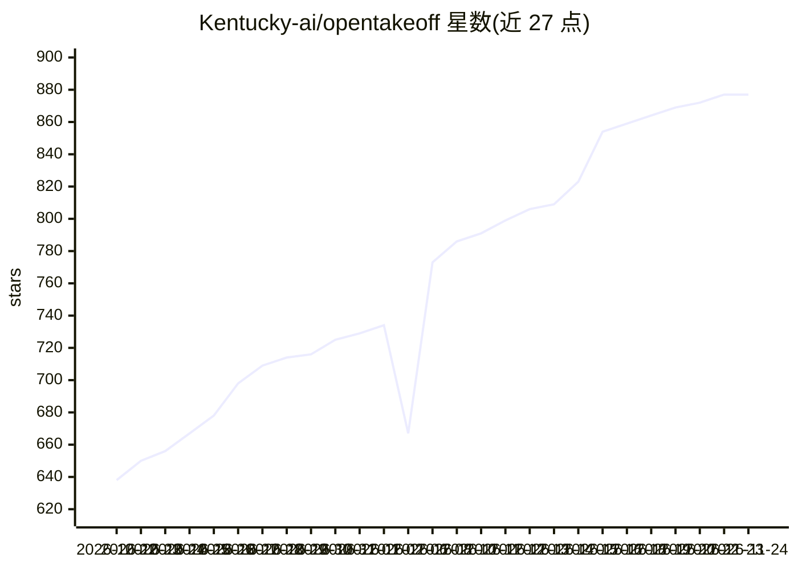

# Kentucky-ai/opentakeoff

⭐ 877 · TypeScript · AGPL-3.0 · 推送 2026-11-22 · [GitHub](https://github.com/Kentucky-ai/opentakeoff) · [官网](https://opentakeoff.kentucky-ai.com) · 组织维护

**给造价/地板估算者与 AI agent 的浏览器端 PDF 工程量测算引擎**

面向建造与地板投标前测算（takeoff）的开源引擎（AGPL-3.0），提供两个前端：浏览器画布供人工拖入图纸、定比例、描房间并导出报告与标注图集；MCP server 以 stdio 提供 70 个工具供 agent 驱动同一引擎。两种前端共享同一 takeoff 格式，每个图形记录比例、绘制方法与人/agent 归属；agent 产物保持虚线提案，须由人在画布接受才生效。数据仅存于浏览器 IndexedDB/localStorage，不上传；比例未经校准则拒绝测量。

## 筛选速览

| 维度 | 判定 | 备注 |
|---|---|---|
| AI 角色 | `ai-enhanced` | 去掉 AI 部分产品仍成立 |
| 许可风险 | `viral` | AGPL-3.0 |
| 部署形态 | `self-host` | docker 或自建部署 |
| 模型依赖 | — | README 未给出锁定关系 |
| 硬件要求 | — | 无带数字的原话,不猜 |
| 安装摩擦 | `low` | 无编译、无系统依赖或容器化 |
| 成熟度 | — | 结构信号不足 |

## 能力要点

- MCP server 提供 70 个分组工具（打开/测量/符号扫描/估价/导出等）
- agent 产物为虚线提案，仅有人工 AP­PROVED 印章可生效
- 全浏览器内运行，工作数据存 IndexedDB 且不上传
- 导出 CSV/JSON/Excel/DXF/标注 PDF，可从 finish schedule 导入条件

## 适用场景

- 投标前在浏览器里对 PDF 图纸量房、算材料与数量
- 把同一测算引擎接入 Claude Code/Cursor 等 MCP 客户端由 agent 执行
- 团队 fork 后部署到自有静态主机做内部测算
- 导出带图例的标注图集与报价 PDF 交付客户

## 场景标签

 · 领域:建筑/工程测算

## 证据(README 行号)

> L20: engine for that job. It has two front ends:
> L22: - **🧑‍🔧 A browser canvas for people.** Drag in a plan set, set the scale, trace rooms, and
> L24: - **🤖 An MCP server for agents.** It offers 70 tools over

## 星数曲线

2026-10-22 638 → 2026-11-24 877（+239）

---
*卡片 v1 · prompt 1.4 · 生成 2026-11-24 · 置信度 high · 依据 README sha `84cdb8e76af2` · [字段定义](../../DATASET.md)*
