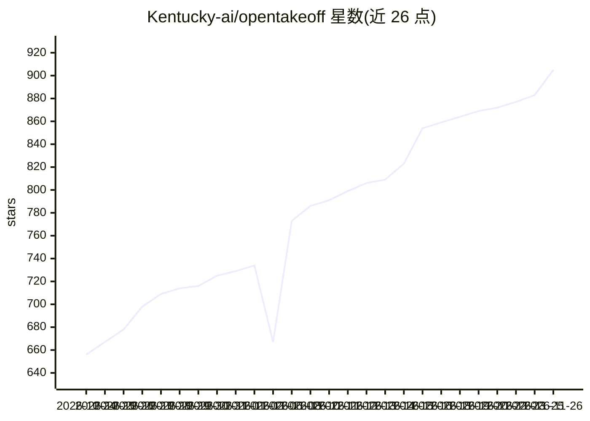

# Kentucky-ai/opentakeoff

⭐ 905 · TypeScript · AGPL-3.0 · 推送 2026-11-24 · [GitHub](https://github.com/Kentucky-ai/opentakeoff) · [官网](https://opentakeoff.kentucky-ai.com) · 组织维护

**给建筑/地板估价人的浏览器端 PDF 工程量测算引擎，可交由 AI agent 经 MCP 驱动**

OpenTakeoff 是开源（AGPL-3.0）的建筑投标工程量测算（takeoff）引擎，完全在浏览器本地运行，不上传文件。提供两个前端：人工操作的画布（拖入图纸、设比例、描房间、导出报告）与面向 AI agent 的 MCP 服务器（stdio 上 70 个工具）。两者共享同一格式与数学；agent 的成果以虚线提案呈现，需人工接受才生效；比例需显式设置，未设比例的图纸拒绝测量。需要 Node 20+ 运行 MCP 服务器。

## 筛选速览

| 维度 | 判定 | 备注 |
|---|---|---|
| AI 角色 | `ai-enhanced` | 去掉 AI 部分产品仍成立 |
| 许可风险 | `viral` | AGPL-3.0 |
| 部署形态 | `self-host` | docker 或自建部署 |
| 模型依赖 | locked-api |  |
| 硬件要求 | — | 无带数字的原话,不猜 |
| 安装摩擦 | `low` | 无编译、无系统依赖或容器化 |
| 成熟度 | — | 结构信号不足 |

## 能力要点

- MCP 服务器提供 70 个工具，与浏览器画布共用同一测算引擎与格式
- agent 工作保持虚线提案状态，仅画布上的操作者可批准生效
- 比例作为门禁：读取图纸比例注释但不自动应用，未设比例拒绝测量
- 本地运行，数据存于 IndexedDB/localStorage，不上传

## 适用场景

- 投标前在浏览器里量算地板面积、墙面与工程量并导出报告
- 把 MCP 服务器接入 Claude Code/Cursor 等，让 agent 批量描图后人工审核
- 自托管一份给施工队内部使用（Netlify 或任意静态主机）

## 场景标签

 · 领域:建筑/工程估算

## 证据(README 行号)

> L23: engine for that job. It has two front ends:
> L27: - **🤖 An MCP server for agents.** It offers 70 tools over
> L149: |**Privacy**|Runs only in the client. Work is stored in IndexedDB and localStorage and is never uploaded|

## 星数曲线

2026-10-24 656 → 2026-11-26 905（+249）

---
*卡片 v1 · prompt 1.4 · 生成 2026-11-25 · 置信度 high · 依据 README sha `823cc5a6dbed` · [字段定义](../../DATASET.md)*
