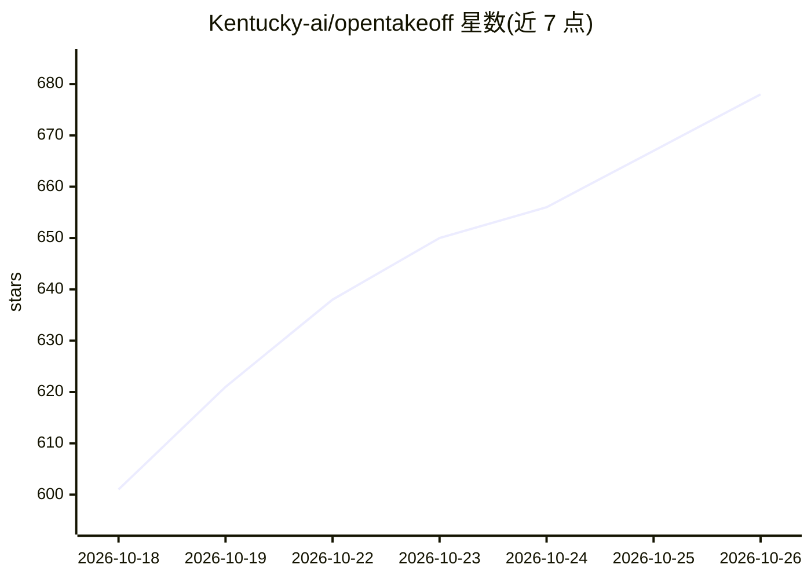

# Kentucky-ai/opentakeoff

⭐ 678 · TypeScript · AGPL-3.0 · 推送 2026-10-25 · [GitHub](https://github.com/Kentucky-ai/opentakeoff) · [官网](https://opentakeoff.kentucky-ai.com) · 组织维护 · 中文 README

**面向 AI agent（MCP）与人工的浏览器端施工图纸算量引擎**

浏览器端（无后端、无上传）的开源建筑图纸 takeoff（算量）引擎，面向施工投标前估价场景。同一引擎提供两套前端：53 个 MCP 工具的 stdio 服务器（npx 安装，Node 20+）供 AI agent 读取图纸、设比例尺、按墙面描摹房间、符号清点并导出标注图；以及浏览器画布供估价师手动描图、材料采购单与卷材排版。每个测量记录比例尺、生成方法与作者（agent 测量带显式 review 状态）。One-Click 房间检测功能当前处于门控停用状态（正在重新验证）。

## 筛选速览

| 维度 | 判定 | 备注 |
|---|---|---|
| AI 角色 | `ai-enhanced` | 去掉 AI 部分产品仍成立 |
| 许可风险 | `viral` | AGPL-3.0 |
| 部署形态 | `library` | 以包/库形式分发 |
| 模型依赖 | — | README 未给出锁定关系 |
| 硬件要求 | — | 无带数字的原话,不猜 |
| 安装摩擦 | `low` | 无编译、无系统依赖或容器化 |
| 成熟度 | `idea` | |

## 能力要点

- 53 个 MCP 工具供 AI agent 驱动算量，与浏览器画布共享同一几何/算量模块
- 每个测量记录比例尺、方法与作者身份，形成审计溯源链
- 无后端无上传的纯客户端浏览器应用，Windows/macOS/Linux 通用
- 支持卷材缝排布、符号清点、图纸层角色读取与跨图拼接

## 适用场景

- 投标前从施工图纸量取地面/墙面材料数量
- 让 AI agent 通过 MCP 自动完成算量并交人工审核
- 小团队自建部署实例（fork 后运行在自己的 URL）

## 场景标签

`文档解析` · 领域:知识与检索

## 证据(README 行号)

> L6: two ways over one engine: ** 53 MCP tools** for an agent, and a browser canvas for a person.
> L83: - **A browser canvas**—no backend, no account, no upload. An estimator drags in a plan set
> L92: **Provenance is the load-bearing part.** Every shape records the scale it was measured at, the

## 星数曲线

2026-10-18 601 → 2026-10-26 678（+77）

---
*卡片 v1 · prompt 1.4 · 生成 2026-10-21 · 置信度 mid · 依据 README sha `0920ef2754c8` · [字段定义](../../DATASET.md)*
