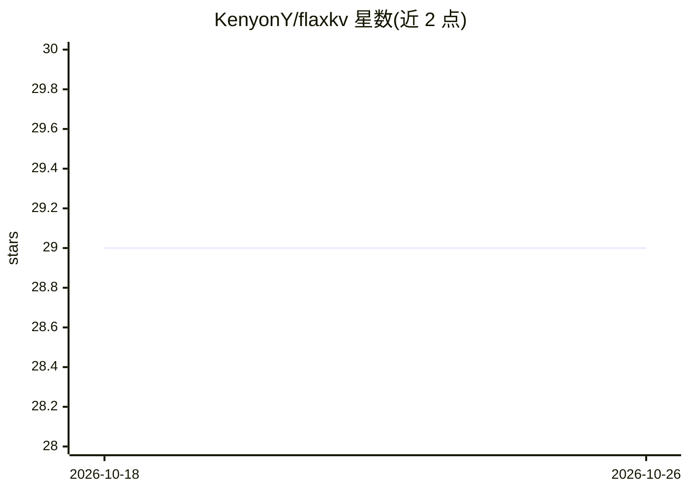

# KenyonY/flaxkv

⭐ 29 · Python · Apache-2.0 · 推送 2025-12-04 · [GitHub](https://github.com/KenyonY/flaxkv) · 个人维护 · 中文 README

**类字典接口的高性能磁盘键值数据库，适合存 ML 向量数据**

以 Python 字典式接口封装的持久化键值数据库：写操作经缓冲异步落盘，不阻塞用户进程，读到的始终是最新写入数据；默认后端为 LevelDB，写操作原子、线程安全，资源释放自动处理，无需显式 close。面向需要在高频写入场景下保存 embedding、图像、文本等键值结构数据的机器学习开发者。限制：多进程环境下因延迟写入，进程间读取有数秒延迟（可调 write_immediately）；值默认不支持 Tuple/Set。以 pip 包分发，另有 server 版本可装。

## 筛选速览

| 维度 | 判定 | 备注 |
|---|---|---|
| AI 角色 | `ai-ecosystem` | LLM/agent 周边工具 |
| 许可风险 | `permissive` | Apache-2.0 |
| 部署形态 | `library` | 以包/库形式分发 |
| 模型依赖 | — | README 未给出锁定关系 |
| 硬件要求 | — | 无带数字的原话,不猜 |
| 安装摩擦 | `low` | 无编译、无系统依赖或容器化 |
| 成熟度 | — | 结构信号不足 |

## 能力要点

- 字典式接口操作持久化数据库，写操作不阻塞用户进程
- 缓冲写入 + 原子写操作，默认后端 LevelDB
- 自动资源释放，支持线程安全并发访问
- 适用于保存 embedding/图像/文本等机器学习键值数据

## 适用场景

- 高频插入/更新的键值数据持久化
- 机器学习中保存 embedding 等大数据集
- 像用 Python 字典一样读写磁盘数据库

## 场景标签

 · 领域:数据库/机器学习存储

## 证据(README 行号)

> L78: - **Machine Learning:**
> L79: `flaxkv` is very suitable for saving various large datasets of embeddings, images, texts, and other key-value struc

## 星数曲线

2026-10-18 29 → 2026-10-26 29（+0）

---
*卡片 v1 · prompt 1.4 · 生成 2026-10-26 · 置信度 mid · 依据 README sha `634befef30bf` · [字段定义](../../DATASET.md)*
