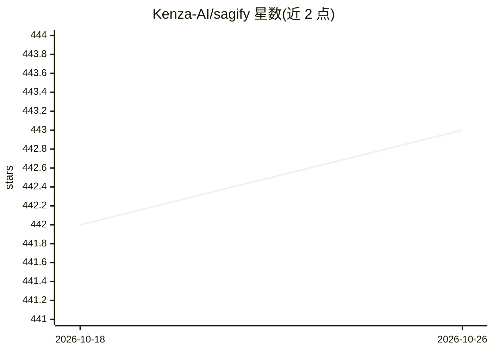

# Kenza-AI/sagify

⭐ 443 · Python · MIT · 推送 2026-02-11 · [GitHub](https://github.com/Kenza-AI/sagify) · [官网](https://kenza-ai.github.io/sagify/) · 组织维护

**AWS SageMaker 上的 ML/LLM 工作流管理与统一 LLM 网关工具**

Sagify 提供简化接口管理 AWS SageMaker 上的机器学习工作流，核心模块 LLM Gateway 以 FastAPI 服务形式提供统一 API，接入 OpenAI（gpt-4、dall-e-3、embeddings 系列）与 SageMaker 上的开源模型（Llama-2、Stable Diffusion v2、bge/gte/e5 等）。开源模型通过 `sagify llm start` 命令部署为 SageMaker 端点（15-30 分钟），网关可本地 Docker 运行或部署到 AWS Fargate，暴露 /v1/chat/completions、/v1/embeddings、/v1/images/generations 接口。要求 Python 3.7-3.11、Docker 与已配置的 awscli，深度绑定 AWS 生态。

## 筛选速览

| 维度 | 判定 | 备注 |
|---|---|---|
| AI 角色 | `ai-ecosystem` | LLM/agent 周边工具 |
| 许可风险 | `permissive` | MIT |
| 部署形态 | `library` | 以包/库形式分发 |
| 模型依赖 | — | README 未给出锁定关系 |
| 硬件要求 | — | 无带数字的原话,不猜 |
| 安装摩擦 | `low` | 无编译、无系统依赖或容器化 |
| 成熟度 | — | 结构信号不足 |

## 能力要点

- FastAPI LLM Gateway 统一接口对接 OpenAI 与 SageMaker 开源模型
- `sagify llm start` 一键将 Llama-2/Stable Diffusion/embedding 模型部署为 SageMaker 端点
- OpenAI 兼容的 completions/embeddings/images API
- 支持本地 Docker 运行与 AWS Fargate 部署

## 适用场景

- 在 AWS 上无代码部署 Stable Diffusion 等 foundation 模型
- 用统一 API 网关切换 OpenAI 与自部署开源模型
- 把 LLM 推理后端纳入 SageMaker 机器学习工作流管理

## 场景标签

`模型网关` `MLOps` · 领域:Agent 开发

## 证据(README 行号)

> L11: Sagify provides a simplified interface to manage machine learning workflows on AWS SageMaker, helping you focus on 
> L141: ## Deploy FastAPI LLM Gateway - Docker
> L204: Once the LLM Gateway is deployed, you can access it on `HOST_NAME/docs`.

## 星数曲线

2026-10-18 442 → 2026-10-26 443（+1）

---
*卡片 v1 · prompt 1.4 · 生成 2026-10-21 · 置信度 high · 依据 README sha `369ce3911502` · [字段定义](../../DATASET.md)*
