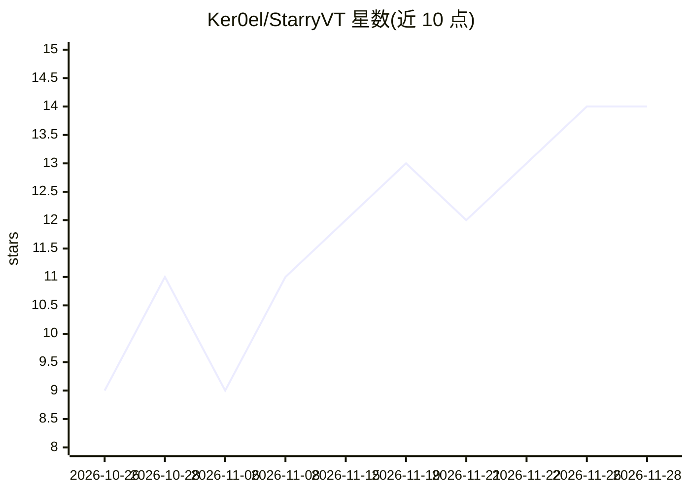

# Ker0el/StarryVT

⭐ 14 · Python · GPL-3.0 · 推送 2026-11-25 · [GitHub](https://github.com/Ker0el/StarryVT) · 个人维护 · 中文 README

**Windows 视频翻译工具：AI 字幕+中文配音+成片，支持 MCP**

面向 Windows 用户的视频翻译流水线：导入本地视频/文件夹或 YouTube/B 站链接，依次执行人声分离、语音识别（faster-whisper 本机运行）、DeepSeek 翻译、MiMo 中文配音、字幕烧录，产出成片 MP4。视频不上传，仅字幕文字经用户自有 API Key 发往服务商。安装包 6.0 起内置 MCP 服务器，AI Agent 可通过 stdio 或本地 HTTP 启动翻译、查询进度、取消任务。需一键初始化下载约 6 GB 运行环境与模型权重，占盘约 12 GB。

## 筛选速览

| 维度 | 判定 | 备注 |
|---|---|---|
| AI 角色 | `ai-native` | 本体是模型或模型工具 |
| 许可风险 | `viral` | GPL-3.0 |
| 部署形态 | `desktop` | 安装包/桌面程序 |
| 模型依赖 | locked-api |  |
| 硬件要求 | `gpu-8g` | |
| 安装摩擦 | `medium` | 含编译或系统依赖之一 |
| 成熟度 | — | 结构信号不足 |

## 能力要点

- 语音识别→AI 翻译→中文配音→烧录成片一键完成
- 视频不上传，识别与压制本机完成，仅字幕文字外发
- 内置 MCP 服务器，支持 stdio 与本地 HTTP 两种模式
- 本机术语库记忆专有名词，支持批量与双语字幕

## 适用场景

- 把外语教程、技术课程批量翻成中文字幕和配音成片
- YouTube/B 站视频本地化后发布
- 中文视频换音色重配或翻成英文给海外观众
- 让 AI Agent 通过 MCP 代为启动和跟踪翻译任务

## 场景标签

`语音合成` `语音识别` `图像视频处理` · 领域:内容生成

## 证据(README 行号)

> L20: 星译（StarryVT，全称 Starry Video Translation）是一款**免费**的 Windows 视频翻译工具。导入一个视频文件、选择整个文件夹，或粘贴一条 YouTube / B 站链接，它会自动完成**语音
> L34: - **🤖 AI Agent 接入**：通过 MCP 让 AI Agent 直接启动翻译、查询进度、取消任务（安装包 6.0 起内置，详见下文）。
> L87: 星译可以把翻译能力通过 MCP 暴露给 AI Agent，让它直接启动翻译、查看进度、取消任务、查询术语库。MCP 服务和界面共用同一套设置、API Key、引擎与输出目录。

## 星数曲线

2026-10-26 9 → 2026-11-28 14（+5）

---
*卡片 v1 · prompt 1.4 · 生成 2026-11-18 · 置信度 mid · 依据 README sha `19b0e8ac4228` · [字段定义](../../DATASET.md)*
