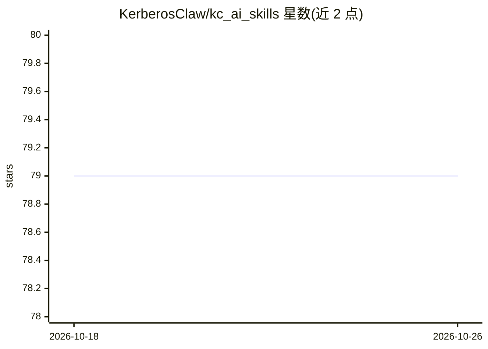

# KerberosClaw/kc_ai_skills

⭐ 79 · Python · MIT · 推送 2026-10-16 · [GitHub](https://github.com/KerberosClaw/kc_ai_skills) · 个人维护 · 中文 README

**中文優先的 Claude Code/Codex agent skills 合集（29 个技能）**

遵循 Claude Code SKILL.md 约定的可复用 agent 技能集合，本仓库 26 个技能加 doc-qa 插件 3 个，覆盖工作流路由、文档生成与对齐、繁中润色、Markdown 转 PDF/PPT、PRD/规格/ADR 交付流程、LoRA 训练编排与无人值守任务派发等。技能兼容任何支持 skill/prompt 加载的 LLM 客户端（云端或本地），部分技能打包为 kc_ai_plugins 插件与所需 MCP 服务器一并安装。默认面向本地开发与可信局域网环境，外部服务技能未实现额外认证层。

## 筛选速览

| 维度 | 判定 | 备注 |
|---|---|---|
| AI 角色 | `ai-knowledge` | 知识聚合/清单类 |
| 许可风险 | `permissive` | MIT |
| 部署形态 | `library` | 以包/库形式分发 |
| 模型依赖 | — | README 未给出锁定关系 |
| 硬件要求 | — | 无带数字的原话,不猜 |
| 安装摩擦 | `low` | 无编译、无系统依赖或容器化 |
| 成熟度 | — | 结构信号不足 |

## 能力要点

- 26 个自包含技能 + doc-qa 插件 3 个技能，按工作流场景分组
- 遵循 Claude Code SKILL.md + scripts/ 约定，框架无关
- 插件形式捆绑技能与所需 MCP 服务器，Claude Code 与 Codex 一步安装
- 含 PRD→ADO 工作项、规格驱动开发、文档对齐等交付链技能

## 适用场景

- 为 Claude Code 或 Codex 客户端加载现成 agent 技能处理文档与交付流程
- 把既有代码库转成技术文档与运维手册
- 让 agent 无人值守执行已冻结规格的过夜任务
- Markdown 报告转 PDF 或演示用 PPTX

## 场景标签

`提示工程` · 领域:Agent 开发

## 证据(README 行号)

> L7: A collection of AI agent skills that solve real problems — not "summarize this PDF" kind of skills, but "scan my rep
> L9: > Skills follow the Claude Code skill convention (SKILL.md + scripts/), but the concepts are framework-agnostic. Thi
> L27: **Start here:** Workflow diagrams, document roles, and the complete skill map. One maintained guide covers the 26 s

## 星数曲线

2026-10-18 79 → 2026-10-26 79（+0）

---
*卡片 v1 · prompt 1.4 · 生成 2026-10-24 · 置信度 mid · 依据 README sha `9cb5385daf39` · [字段定义](../../DATASET.md)*
