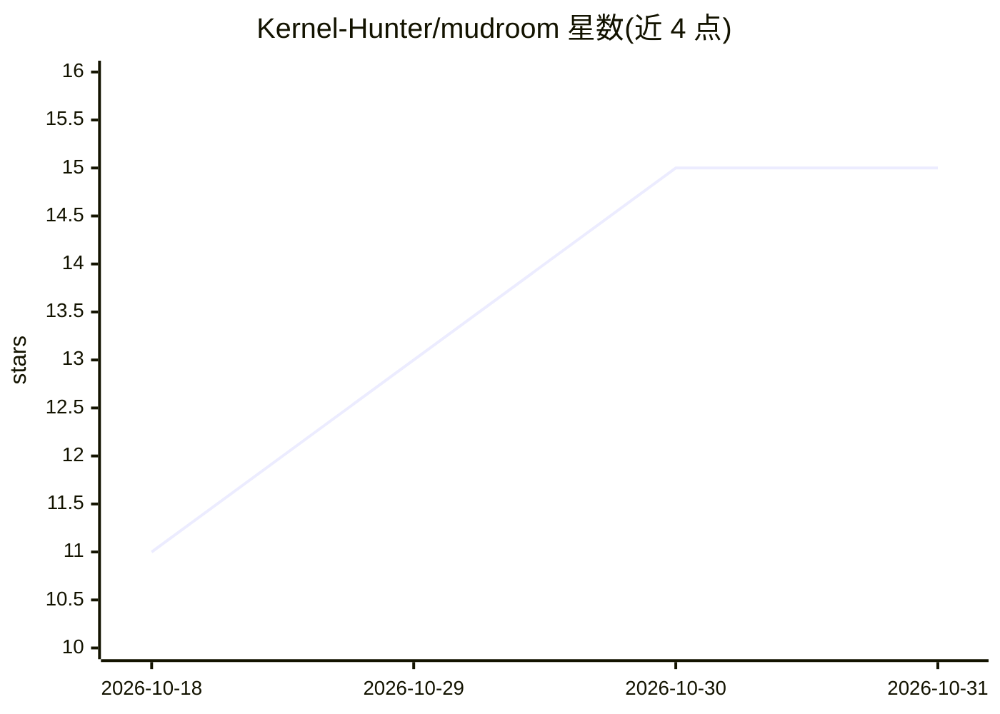

# Kernel-Hunter/mudroom

⭐ 15 · Swift · MIT · 推送 2026-10-30 · [GitHub](https://github.com/Kernel-Hunter/mudroom) · [官网](https://kernel-hunter.github.io/mudroom/) · 个人维护

**在 Linux 微型 VM 沙箱中运行编码代理并按 PR 方式审查变更**

面向使用 Claude Code、Codex、Gemini CLI、opencode、Aider 等编码代理的开发者的沙箱运行器：在写时复制克隆的项目目录里、于 Apple container/Docker/Podman 支撑的 Linux 微型 VM 中运行代理，真实目录不被挂载，网络访问按主机白名单受限并记录日志。代理完成后可按文件/代码块粒度审阅与应用 diff，每步可撤销，并检测与本地修改的冲突。macOS（Apple silicon）提供 App 与 CLI，其他平台仅 CLI；自述为早期原型。

## 筛选速览

| 维度 | 判定 | 备注 |
|---|---|---|
| AI 角色 | `ai-ecosystem` | LLM/agent 周边工具 |
| 许可风险 | `permissive` | MIT |
| 部署形态 | `desktop` | 安装包/桌面程序 |
| 模型依赖 | local-ok | 支持本地模型 |
| 硬件要求 | — | 无带数字的原话,不猜 |
| 安装摩擦 | `low` | 无编译、无系统依赖或容器化 |
| 成熟度 | `idea` | |

## 能力要点

- 在写时复制克隆上运行代理，真实目录不挂载
- 按主机白名单限制并记录 VM 网络访问
- diff 按文件/代码块粒度选择性应用，支持一步撤销与冲突标记
- CLI 可运行任意命令，提供快照时间线回看

## 适用场景

- 关掉权限提示运行编码代理而不担心其删除文件或访问主机
- 审查代理改动后只应用部分文件或代码块
- 查看会话期间代理尝试访问的全部主机并按需放行

## 场景标签

`代码审查` · 领域:编码与开发

## 证据(README 行号)

> L8: runs Claude Code, Codex, Gemini CLI, opencode, Aider (or any command) in a
> L9: Linux micro-VM, on a copy-on-write clone of your project, with network access
> L11: agent is done you read the diff, apply all of it, some files, some hunks or

## 星数曲线

2026-10-18 11 → 2026-10-31 15（+4）

---
*卡片 v1 · prompt 1.4 · 生成 2026-10-30 · 置信度 mid · 依据 README sha `abccf1b2717e` · [字段定义](../../DATASET.md)*
