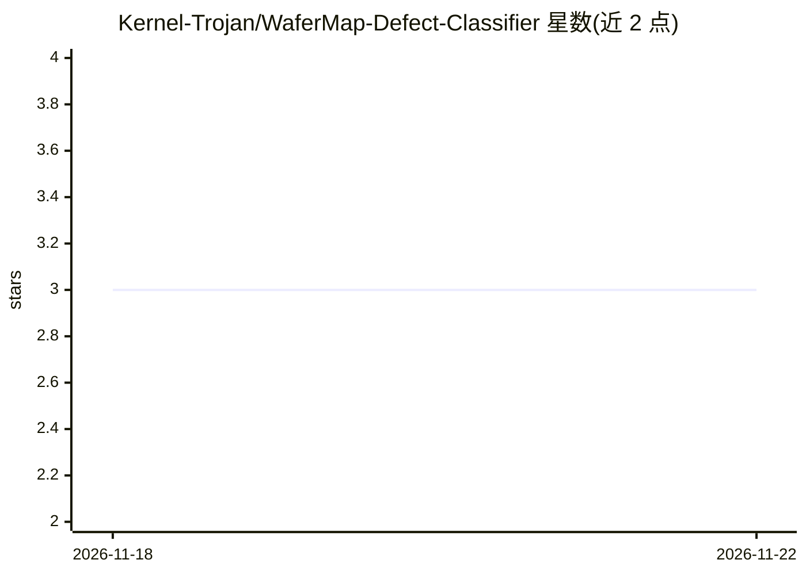

# Kernel-Trojan/WaferMap-Defect-Classifier

⭐ 3 · Python · MIT · 推送 2026-11-17 · [GitHub](https://github.com/Kernel-Trojan/WaferMap-Defect-Classifier) · [官网](https://kernel-trojan.github.io/WaferMap-Defect-Classifier/) · 个人维护

**半导体晶圆图缺陷模式分类的机器学习流水线**

课程项目实现的晶圆图缺陷分类流水线：不使用反向传播，用 k-means 从 5×5 图像块学习滤波器，配合三角激活、四旋转与环形池化，再以带温度缩放的逻辑回归输出 9 类缺陷标签。使用 WM-811K 数据集（35,519 张晶圆，按 lot 分组切分并提供 21 项泄漏检查），锁定测试集 macro-F1 0.765，报告旋转不变性与校准指标，并附完整局限说明。面向机器学习课程/教学与晶圆缺陷模式识别研究者复现与学习。

## 筛选速览

| 维度 | 判定 | 备注 |
|---|---|---|
| AI 角色 | `ai-native` | 本体是模型或模型工具 |
| 许可风险 | `permissive` | MIT |
| 部署形态 | `library` | 以包/库形式分发 |
| 模型依赖 | — | README 未给出锁定关系 |
| 硬件要求 | — | 无带数字的原话,不猜 |
| 安装摩擦 | `low` | 无编译、无系统依赖或容器化 |
| 成熟度 | — | 结构信号不足 |

## 能力要点

- 无反向传播的 CNN 式结构：k-means 滤波器 + 环形池化 + 逻辑回归
- 按 lot 分组切分与 21 项泄漏检查，测试集仅评分一次
- 提供 6 个基线对比、消融实验与 1000 次 bootstrap 误差区间
- 含明确的局限性分析（类别分布偏移、Scratch/Loc 偏弱等）

## 适用场景

- 复现无反向传播 CNN 式特征学习的教学实验
- 对 WM-811K 晶圆图做缺陷模式分类
- 学习严格的数据切分与泄漏检查方法

## 场景标签

 · 领域:半导体制造/机器学习研究

## 证据(README 行号)

> L3: **A CNN-style pipeline with no backprop, for sorting semiconductor wafer maps into defect patterns.**
> L41: |**Target**|One of 9 labels: Center, Donut, Edge-Loc, Edge-Ring, Loc, Near-full, Random, Scratch, none|

## 星数曲线

2026-11-18 3 → 2026-11-22 3（+0）

---
*卡片 v1 · prompt 1.4 · 生成 2026-11-22 · 置信度 mid · 依据 README sha `7255801bdb4c` · [字段定义](../../DATASET.md)*
