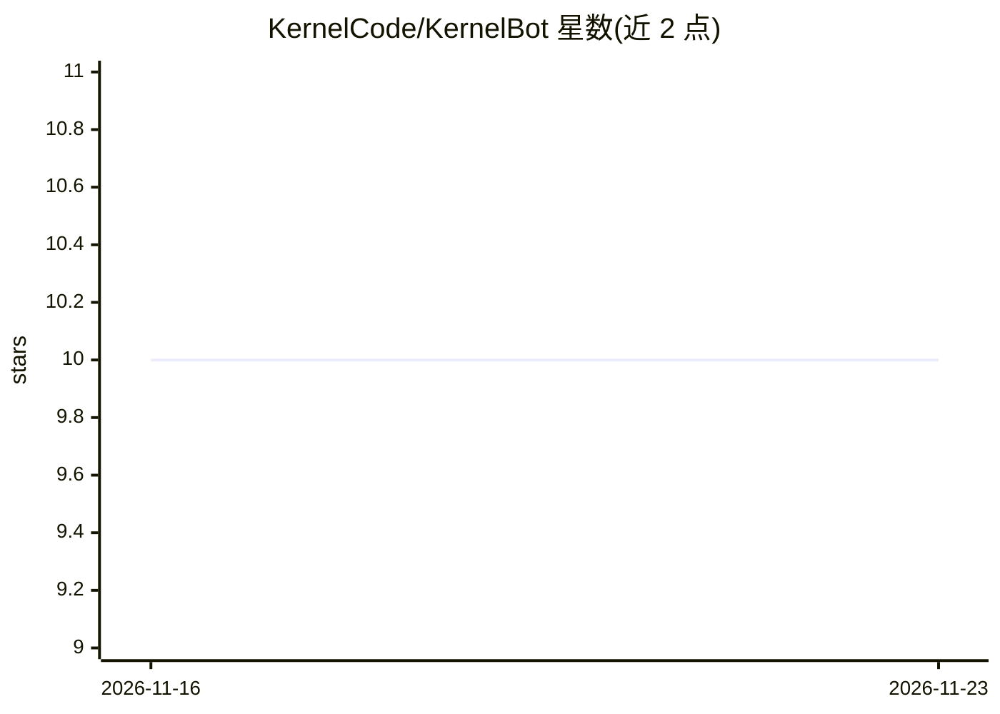

# KernelCode/KernelBot

⭐ 10 · JavaScript · 推送 2026-03-08 · [GitHub](https://github.com/KernelCode/KernelBot) · [官网](https://kernelbot.io) · 个人维护

**为个人用户提供自进化、带持久记忆的多 agent 助手系统**

运行在本机的 AI agent 系统：orchestrator 接收消息后向 coding/browser/system/devops/research 五类 worker 分发任务，worker 使用 shell、git、Docker、浏览器等 40+ 工具并行执行。核心机制是把世界模型、因果记忆、行为特征、反馈信号持久化到单一 brain.sqlite 文件（35+ 表、6 个向量索引），每 6 小时做记忆整合，并可通过 PR 提出自身改进（不自动合并）。以 Telegram 为交互界面，模型可切换。需 Node.js 18+ 与所选 provider 的 API key，许可为 BSL 1.1。

## 筛选速览

| 维度 | 判定 | 备注 |
|---|---|---|
| AI 角色 | `ai-ecosystem` | LLM/agent 周边工具 |
| 许可风险 | `none` | — |
| 部署形态 | `library` | 以包/库形式分发 |
| 模型依赖 | locked-api |  |
| 硬件要求 | — | 无带数字的原话,不猜 |
| 安装摩擦 | `low` | 无编译、无系统依赖或容器化 |
| 成熟度 | — | 结构信号不足 |

## 能力要点

- orchestrator + 五类专用 worker 的多 agent 并行架构，带实时进度更新
- brain.sqlite 单文件持久化：世界模型、因果记忆、行为特征与 6 个向量索引
- 多 provider 可切换：Anthropic/OpenAI/Gemini/Groq，用 /brain 或 /orchestrator 切换
- 语音输入输出（ElevenLabs + Whisper）与 35+ persona 技能

## 适用场景

- 在个人机器上让 agent 代为完成编码、运维、网页调研等任务
- 让助手长期记住项目、团队与任务成败原因并在对话间延续
- 部署需身份与权限隔离的多用户 Telegram 助手

## 场景标签

`多智能体` `AI 助手` · 领域:Agent 开发

## 证据(README 行号)

> L5: A self-evolving AI agent system that runs on your machine. KernelBot doesn't just respond to messages — it thinks, l
> L39: Orchestrator + five specialized worker types (coding, browser, system, devops, research) running in parallel with l
> L87: npm install -g kernelbot

## 星数曲线

2026-11-16 10 → 2026-11-23 10（+0）

---
*卡片 v1 · prompt 1.4 · 生成 2026-11-20 · 置信度 high · 依据 README sha `8d0c0c4e9dd4` · [字段定义](../../DATASET.md)*
