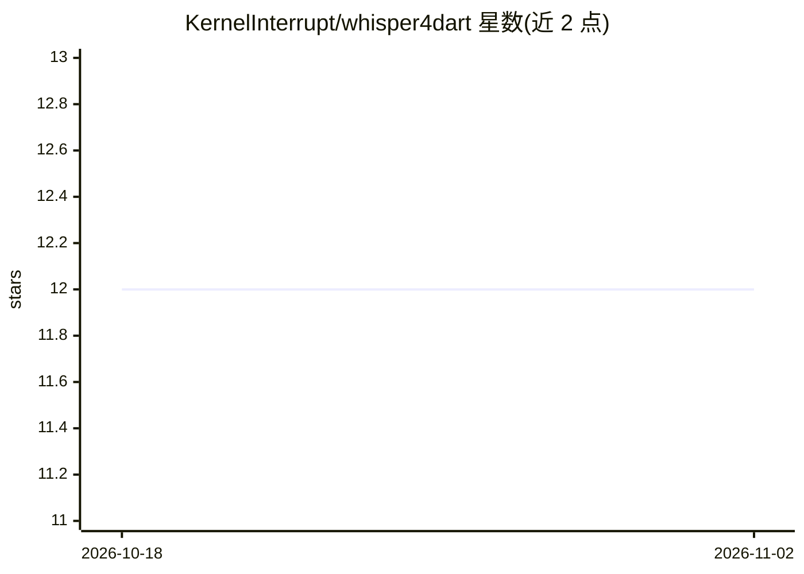

# KernelInterrupt/whisper4dart

⭐ 12 · Dart · Apache-2.0 · 推送 2026-03-02 · [GitHub](https://github.com/KernelInterrupt/whisper4dart) · 个人维护

**面向 Dart/Flutter 的 whisper.cpp 封装库，提供语音转文字**

用 Dart 封装 whisper.cpp 的语音识别包：内置基于 ffmpeg 的解码/解复用，支持大多数音视频文件输入而非仅限 wav；提供 plaintext/txt/json/srt 四种输出模式，支持 isolate 后台推理（inferIsolate）与实时流式输出（inferStream，返回文本与进度的 ValueNotifier）。覆盖 Windows/Linux/Android 平台，iOS 与 macOS 尚未支持，也不计划支持 web。安装包含 pub 包与运行 setup 脚本（预编译或源码编译 whisper.cpp）。

## 筛选速览

| 维度 | 判定 | 备注 |
|---|---|---|
| AI 角色 | `ai-native` | 本体是模型或模型工具 |
| 许可风险 | `permissive` | Apache-2.0 |
| 部署形态 | `None` |  |
| 模型依赖 | — | README 未给出锁定关系 |
| 硬件要求 | — | 无带数字的原话,不猜 |
| 安装摩擦 | `medium` | 含编译或系统依赖之一 |
| 成熟度 | — | 结构信号不足 |

## 能力要点

- 基于 ffmpeg 解码，支持大多数音视频文件输入
- plaintext/txt/json/srt 四种转录输出模式
- inferIsolate 后台隔离推理与 inferStream 实时流式输出
- 提供预编译库与源码自编译两种 setup 方式

## 适用场景

- 在 Flutter 应用中集成离线语音转文字
- 处理 wav 以外的音视频文件做字幕或文本转录
- 转录过程中实时展示进度与部分结果

## 场景标签

`语音识别` · 领域:感知与多模态

## 证据(README 行号)

> L3: whisper4dart is a dart wrapper for whisper.cpp, designed to offer an all-in-one speech recognition experience. With 
> L64:  And so my fellow Americans, ask not what your country can do for you, ask what you can do for your country.

## 星数曲线

2026-10-18 12 → 2026-11-02 12（+0）

---
*卡片 v1 · prompt 1.4 · 生成 2026-11-01 · 置信度 high · 依据 README sha `99b9cd04d90e` · [字段定义](../../DATASET.md)*
