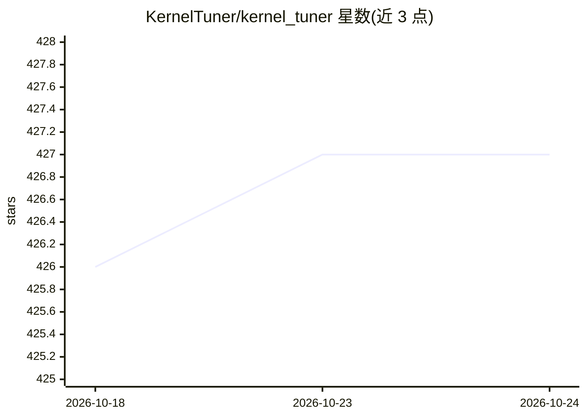

# KernelTuner/kernel_tuner

⭐ 427 · Python · Apache-2.0 · 推送 2026-10-16 · [GitHub](https://github.com/KernelTuner/kernel_tuner) · [官网](https://kerneltuner.github.io/kernel_tuner/) · 组织维护

**面向开发者的 GPU kernel 自动调优框架（CUDA/HIP/OpenCL 等）**

以 Python 库形式提供的 GPU kernel 基准测试与自动调优工具：作为外部工具在隔离环境中对已有 kernel 代码做参数搜索调优，无需大幅改动代码，支持 CUDA、HIP、OpenCL、OpenACC、OpenMP 等主流 GPU 编程语言，配合任意宿主语言的应用使用。提供 20 余种搜索/优化算法、能耗测量（功率上限、频率调节）、输出校验、缓存与自定义指标等功能。安装需先具备 CUDA/OpenCL/HIP 编译器，再通过 pip 安装；另有教程笔记本（含 Colab）与论文引用入口。

## 筛选速览

| 维度 | 判定 | 备注 |
|---|---|---|
| AI 角色 | `ai-enhanced` | 去掉 AI 部分产品仍成立 |
| 许可风险 | `permissive` | Apache-2.0 |
| 部署形态 | `library` | 以包/库形式分发 |
| 模型依赖 | — | README 未给出锁定关系 |
| 硬件要求 | — | 无带数字的原话,不猜 |
| 安装摩擦 | `medium` | 含编译或系统依赖之一 |
| 成熟度 | — | 结构信号不足 |

## 能力要点

- 对现有 kernel 代码做隔离式基准测试与调优，无需大幅改动
- 支持 CUDA/HIP/OpenCL/OpenACC/OpenMP 多种 GPU 编程语言
- 20 余种优化搜索算法
- 能耗测量与优化（功率上限、时钟频率调节）

## 适用场景

- 为 CUDA/OpenCL 等 GPU kernel 搜索最优配置参数
- 对 GPU 代码做时间或能耗目标的基准测试
- 从 Python 中测试并调优 kernel 的宿主与设备代码

## 场景标签

 · 领域:GPU 计算/性能工程

## 证据(README 行号)

> L9: Create optimized GPU applications in any mainstream GPU
> L10: programming language (CUDA, HIP, OpenCL, OpenACC, OpenMP).

## 星数曲线

2026-10-18 426 → 2026-10-24 427（+1）

---
*卡片 v1 · prompt 1.4 · 生成 2026-10-21 · 置信度 low · 依据 README sha `35ab2b24e425` · [字段定义](../../DATASET.md)*
