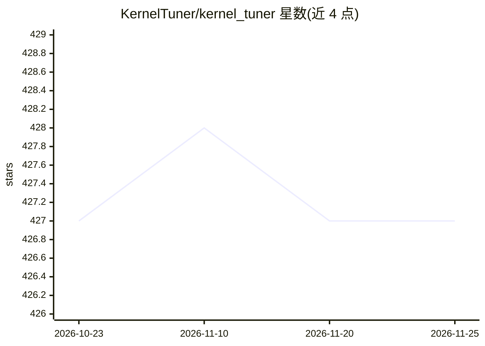

# KernelTuner/kernel_tuner

⭐ 427 · Python · Apache-2.0 · 推送 2026-11-16 · [GitHub](https://github.com/KernelTuner/kernel_tuner) · [官网](https://kerneltuner.github.io/kernel_tuner/) · 组织维护

**面向 GPU 开发者的内核自动调优工具库**

Python 编写的 GPU 内核自动调优工具：作为外部工具对现有 CUDA/HIP/OpenCL/OpenACC/OpenMP 内核代码进行基准测试与参数搜索优化，无需大规模改动既有内核，支持任意宿主语言的应用。内置 20 多种优化算法加速调优搜索，提供能耗测量与优化（功耗上限、时钟频率调节）、输出验证、缓存、混合精度与精度调优、自定义指标等功能。通过 pip 安装，配套教程、示例与 Colab notebook，并有 C++ 集成、可视化监控等生态组件。

## 筛选速览

| 维度 | 判定 | 备注 |
|---|---|---|
| AI 角色 | `ai-enhanced` | 去掉 AI 部分产品仍成立 |
| 许可风险 | `permissive` | Apache-2.0 |
| 部署形态 | `library` | 以包/库形式分发 |
| 模型依赖 | — | README 未给出锁定关系 |
| 硬件要求 | — | 无带数字的原话,不猜 |
| 安装摩擦 | `medium` | 含编译或系统依赖之一 |
| 成熟度 | — | 结构信号不足 |

## 能力要点

- 支持 CUDA、HIP、OpenCL、OpenACC、OpenMP 多种 GPU 编程模型
- 20 多种优化算法用于加速调优搜索空间
- 能耗测量与优化（power capping、时钟频率调优）
- 可直接用于现有内核代码并提供输出验证

## 适用场景

- 对现有 CUDA 内核做基准测试并自动搜索最优配置
- 优化 GPU 应用的能耗表现
- 从 Python 中测试和调优 GPU 代码
- 混合精度与精度调优实验

## 场景标签

 · 领域:高性能计算/GPU 内核优化

## 证据(README 行号)

> L9: Create optimized GPU applications in any mainstream GPU
> L14: - Works as an external tool to benchmark and optimize GPU kernels in isolation
> L18: - More than 20 optimization algorithms to speedup tuning

## 星数曲线

2026-10-23 427 → 2026-11-25 427（+0）

---
*卡片 v1 · prompt 1.4 · 生成 2026-11-25 · 置信度 mid · 依据 README sha `f36f74330e37` · [字段定义](../../DATASET.md)*
