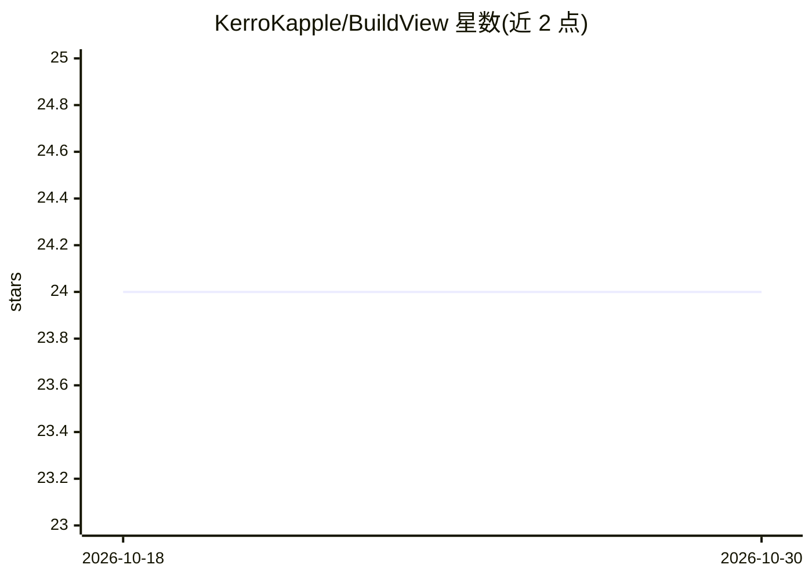

# KerroKapple/BuildView

⭐ 24 · Python · MIT · 推送 2026-09-19 · [GitHub](https://github.com/KerroKapple/BuildView) · 个人维护 · 中文 README

**建筑工程领域的私有化 RAG 问答与项目智能分析平台**

基于 FastAPI 构建的建筑工程知识库与项目管理双核系统：文档管道支持 PDF/Word/扫描件（PaddleOCR）解析、分块与向量化；检索层提供 Milvus 向量检索、BM25 关键词、混合检索、Cross-Encoder 重排与 Neo4j 图增强检索；LLM 层可接 OpenAI/通义千问/GLM/Ollama/vLLM，未检索到内容时不调用模型直接返回「文档中未找到」。另含 5 个项目管理 Agent（周报/成本/进度/安全/风险）与施工图实体提取入图功能。通过 Docker Compose 部署基础服务，Python 3.9+ 运行。

## 筛选速览

| 维度 | 判定 | 备注 |
|---|---|---|
| AI 角色 | `ai-native` | 本体是模型或模型工具 |
| 许可风险 | `permissive` | MIT |
| 部署形态 | `self-host` | docker 或自建部署 |
| 模型依赖 | local-ok | 支持本地模型 |
| 硬件要求 | — | 无带数字的原话,不猜 |
| 安装摩擦 | `low` | 无编译、无系统依赖或容器化 |
| 成熟度 | — | 结构信号不足 |

## 能力要点

- 混合检索：Milvus 向量 + BM25 + Cross-Encoder 重排 + 图增强
- 5 个项目智能分析 Agent（周报/成本/进度/安全/风险，含 CPI/SPI 指标）
- 施工图解析：提取构件/材料/尺寸实体并存入 Neo4j 知识图谱
- 未检索到内容不调用 LLM，Prompt 限制模型编造

## 适用场景

- 企业内部工程文档的私有化智能问答
- 工程项目成本、进度、安全的多维度分析预警
- 施工图纸的构件与材料知识提取管理

## 场景标签

`RAG` `文档问答` `知识图谱` · 领域:知识与检索

## 证据(README 行号)

> L3: > **筑见 BuildView** - 基于 Milvus + PostgreSQL + Redis + Neo4j + 大模型的建筑工程「知识库 + 项目智能」双核平台
> L52: - 强约束回答来源：未检索到内容 → 明确返回「文档中未找到」
> L267: |**问答**|`/api/v1/qa`|RAG 智能问答|

## 星数曲线

2026-10-18 24 → 2026-10-30 24（+0）

---
*卡片 v1 · prompt 1.4 · 生成 2026-10-27 · 置信度 mid · 依据 README sha `3224b7fe9745` · [字段定义](../../DATASET.md)*
