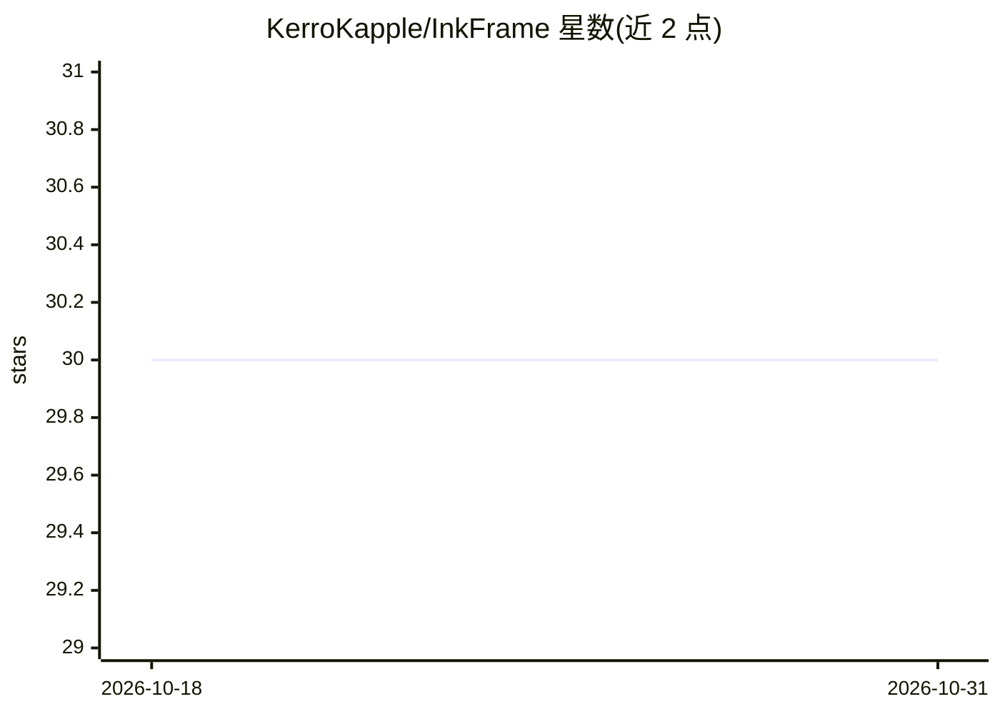

# KerroKapple/InkFrame

⭐ 30 · Dart · MIT · 推送 2026-10-30 · [GitHub](https://github.com/KerroKapple/InkFrame) · 个人维护 · 中文 README

**本地优先的 AI 影视创作桌面工作站：节点画布串联图文视频生成**

Flutter 桌面应用（macOS + Windows），以节点画布组织 prompt→图片→视频的创作链路，接入 DashScope(Wanx)、Kling、Gemini、OpenAI GPT-Image、Stability 等 9 个内置生成服务商，同一项目内可混用多厂商模型。项目文件存于本机内嵌 PostgreSQL，API key 存入系统 Keychain/Credential Manager，无云端账户；内置假服务商支持不耗配额的离线开发模式。处于 v0.1.0-alpha 阶段，需从源码构建（Flutter ≥3.41、PostgreSQL 17 本地二进制），无预编译安装包。ComfyUI 本地 Stable Diffusion、Runway、Midjourney 等为 Help wanted 待接入项。

## 筛选速览

| 维度 | 判定 | 备注 |
|---|---|---|
| AI 角色 | `ai-native` | 本体是模型或模型工具 |
| 许可风险 | `permissive` | MIT |
| 部署形态 | `None` |  |
| 模型依赖 | — | README 未给出锁定关系 |
| 硬件要求 | — | 无带数字的原话,不猜 |
| 安装摩擦 | `low` | 无编译、无系统依赖或容器化 |
| 成熟度 | `idea` | |

## 能力要点

- 节点画布串联文本/图片/视频节点并实时显示生成进度
- 多服务商混用：9 个内置 image/video 提供商，单文件即可新增
- 本地优先：项目存内嵌 PostgreSQL，密钥存 OS Keychain
- 内置假服务商的离线开发模式，不消耗 API 配额

## 适用场景

- 在节点画布上编排镜头并生成图片/视频素材
- 在一个项目中混用多家图片与视频生成服务商
- 不依赖云账户地本地保存项目与 API 密钥

## 场景标签

`图像生成` `视频生成` · 领域:内容生成

## 证据(README 行号)

> L7: **Local-first AI filmmaking workstation — wire text, image, and video AI into one node canvas, on your own machine.*
> L15: InkFrame is a desktop workstation for AI-driven filmmaking. A node-based canvas lets you chain

## 星数曲线

2026-10-18 30 → 2026-10-31 30（+0）

---
*卡片 v1 · prompt 1.4 · 生成 2026-10-26 · 置信度 high · 依据 README sha `c710e5871d85` · [字段定义](../../DATASET.md)*
