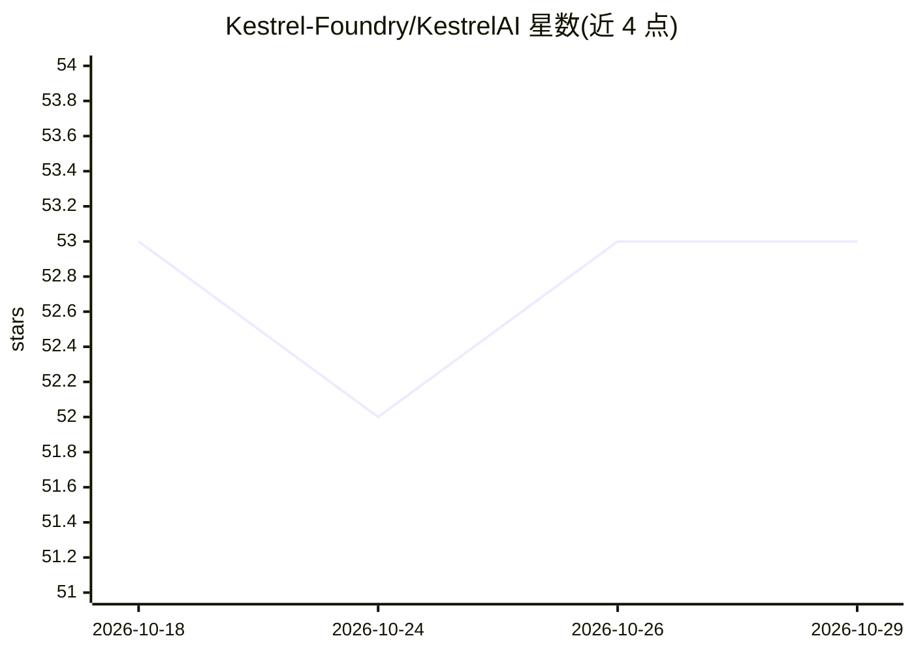

# Kestrel-Foundry/KestrelAI

⭐ 53 · Python · MIT · 推送 2026-03-22 · [GitHub](https://github.com/Kestrel-Foundry/KestrelAI) · 个人维护

**本地小模型驱动的自调度长期研究助手**

面向研究人员的本地优先研究助手：由 Orchestrator 规划/调度任务，Research Agent 执行搜索、检索、过滤、提取与摘要等微任务，在后台长时间运行并输出可审计的检查点供用户审阅与调整，而非单份最终报告。专为 1–7B 小模型设计，通过 Ollama 运行，支持 macOS/Windows/Linux，CPU 即可运行。后端 FastAPI + React 前端 + Redis 中间件，经 Docker Compose 部署，提供 Hummingbird/Kestrel/Albatross 三种调度档位（分钟级到天级）。README 标注项目尚在建设中。

## 筛选速览

| 维度 | 判定 | 备注 |
|---|---|---|
| AI 角色 | `ai-native` | 本体是模型或模型工具 |
| 许可风险 | `permissive` | MIT |
| 部署形态 | `self-host` | docker 或自建部署 |
| 模型依赖 | local-ok | 支持本地模型 |
| 硬件要求 | `cpu-ok` | |
| 安装摩擦 | `low` | 无编译、无系统依赖或容器化 |
| 成熟度 | `idea` | |

## 能力要点

- Orchestrator 长时程调度，输出可审计检查点而非单一报告
- 面向 1–7B 小模型设计，Ollama 运行，CPU 可用、GPU 可选
- 记录检索来源及其对探索与结论的影响（Source Provenance）
- 三档调度档位：分钟级/多小时/天级探索

## 适用场景

- 研究者在解读前沿论文时，让其在后台收集工具对比与性能引用证据
- 长时程后台研究任务，期间审阅检查点并调整方向
- 在笔记本/台式机上本地运行研究代理，不依赖服务器集群

## 场景标签

`科研工具` · 领域:学习与行业

## 证据(README 行号)

> L25: **Kestrel** is a local-first research assistant that self-schedules and executes support tasks over long horizons s
> L27: **Designed for small local models.** Kestrel is built to run with **small LLMs (~1–7B)** via **Ollama**, so it’s **
> L37: - **Research Agent** — Executes concrete micro-tasks (search → retrieve → filter → extract → narrow summary) and pr

## 星数曲线

2026-10-18 53 → 2026-10-29 53（+0）

---
*卡片 v1 · prompt 1.4 · 生成 2026-10-24 · 置信度 high · 依据 README sha `0e933d996a67` · [字段定义](../../DATASET.md)*
