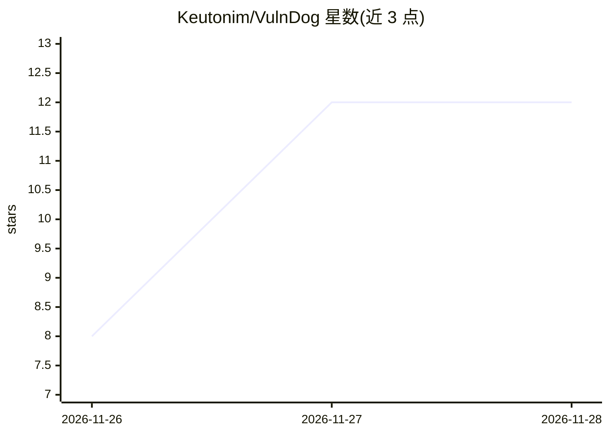

# Keutonim/VulnDog

⭐ 12 · Python · MIT · 推送 2026-11-23 · [GitHub](https://github.com/Keutonim/VulnDog) · 个人维护

**给漏洞猎手的本地被动代理：标记流量中值得追查的请求**

本地运行的被动观测代理：用户自己向目标发送请求，VulnDog 捕获流经代理的流量，对每个请求与离线知识库（456,460 条 CVE/CWE/exploit 记录的 SQLite 库）做混合匹配（确定性规则加本地 Ollama 嵌入的语义匹配），输出 advisory 候选高亮，不自动定性也不主动发请求。带 scope/SSRF 默认拒绝轨道、持久化前脱敏、远程绑定强制凭证等安全机制；提供 stdio MCP server 供 AI agent 查询匹配结果。仅 CLI，MIT 许可，零运行时依赖；尚无公开 release，漏洞库需自行构建。

## 筛选速览

| 维度 | 判定 | 备注 |
|---|---|---|
| AI 角色 | `ai-native` | 本体是模型或模型工具 |
| 许可风险 | `permissive` | MIT |
| 部署形态 | `library` | 以包/库形式分发 |
| 模型依赖 | local-ok | 支持本地模型 |
| 硬件要求 | — | 无带数字的原话,不猜 |
| 安装摩擦 | `low` | 无编译、无系统依赖或容器化 |
| 成熟度 | `idea` | |

## 能力要点

- 离线 456k 记录知识库与规则+本地嵌入的混合匹配引擎
- 被动观测语义：从不自己发请求，输出仅为 advisory 候选
- stdio MCP server（vuln_query/highlights/run_status）供 AI agent 查询
- SSRF 默认拒绝轨道与持久化前脱敏（fail-closed）

## 适用场景

- bug bounty 挖洞时过滤代理历史里的噪声请求
- 内网渗透测试中监控自己发出的流量并提示已知漏洞模式
- 让 AI agent 通过 MCP 查询哪些请求命中已知漏洞模式

## 场景标签

`网络安全` · 领域:学习与行业

## 证据(README 行号)

> L13: it, and scores each request against an offline knowledge base of 456k CVE/CWE/exploit
> L18: Zero dependencies, stdlib Python, local Ollama embeddings for semantic matching,
> L71:  There is no chat completion, no prompt, no per-request LLM verdict anywhere in

## 星数曲线

2026-11-26 8 → 2026-11-28 12（+4）

---
*卡片 v1 · prompt 1.4 · 生成 2026-11-26 · 置信度 high · 依据 README sha `2928f6d450bb` · [字段定义](../../DATASET.md)*
