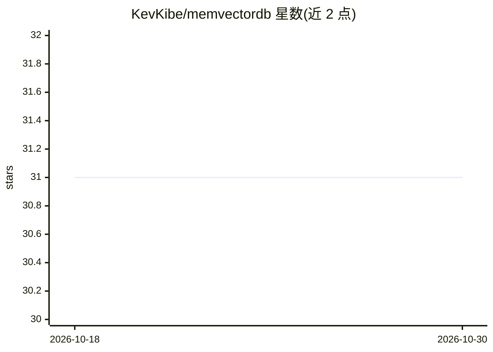

# KevKibe/memvectordb

⭐ 31 · Rust · 推送 2026-09-07 · [GitHub](https://github.com/KevKibe/memvectordb) · 个人维护

**Rust 编写的内存向量数据库，支持元数据存储与日志恢复**

用 Rust 实现的内存向量数据库，以 HTTP 服务形式运行于 localhost:8000，向量存储在内存中，支持元数据存储（面向 RAG 应用与管线）、垂直扩展与从日志全量恢复数据。提供 Python 客户端，附带在 MacBook Air M1 上 10 万请求的 POST/GET/PUT/DELETE 负载测试结果。安装方式为 git clone 源码经 make 构建运行，或拉取 Docker 镜像（x86_64 原生，ARM 经 linux/amd64 平台指定运行）。MIT 许可。

## 筛选速览

| 维度 | 判定 | 备注 |
|---|---|---|
| AI 角色 | `ai-ecosystem` | LLM/agent 周边工具 |
| 许可风险 | `none` | — |
| 部署形态 | `self-host` | docker 或自建部署 |
| 模型依赖 | — | README 未给出锁定关系 |
| 硬件要求 | — | 无带数字的原话,不猜 |
| 安装摩擦 | `low` | 无编译、无系统依赖或容器化 |
| 成熟度 | — | 结构信号不足 |

## 能力要点

- 向量存于内存，支持元数据存储（面向 RAG 应用）
- 从日志全量恢复数据
- 提供 Docker 镜像与 Python 客户端
- MIT 许可开源

## 适用场景

- 为 RAG 管线提供轻量的向量存储与检索服务
- 本地开发环境快速起一个向量数据库实例
- 需要可从日志恢复数据的内存向量存储场景

## 场景标签

`向量数据库` · 领域:知识与检索

## 证据(README 行号)

> L1: # MemVectorDB
> L7: - **Metadata Support:** Supports metadata storage, beneficial for RAG (Retrieval Augmented Generation) applications 

## 星数曲线

2026-10-18 31 → 2026-10-30 31（+0）

---
*卡片 v1 · prompt 1.4 · 生成 2026-10-26 · 置信度 high · 依据 README sha `db25b9087322` · [字段定义](../../DATASET.md)*
