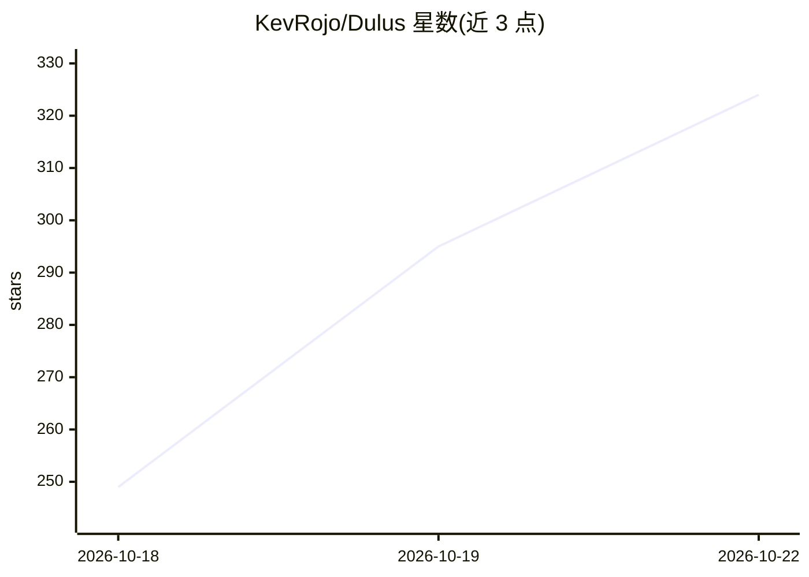

# KevRojo/Dulus

⭐ 324 · Python · GPL-3.0 · 推送 2026-10-19 · [GitHub](https://github.com/KevRojo/Dulus) · [官网](https://dulus.ai/) · 个人维护

**开源 AI agent 运行时：一个引擎接入多家模型与本地模型**

Python 编写的 agent 运行时，安装后即得到可通过终端、浏览器、桌面应用或 Telegram 操作的 AI agent。接入方式包括 Dulus 账号（Fuel/$DULUS 代币计费的托管路由，OpenAI 兼容端点）、自带 API key（Anthropic/OpenAI/Gemini/DeepSeek 等）、OAuth 复用现有订阅，以及 Ollama/LM Studio/edge 本地离线运行。提供 2,186+ MCP 工具、100,000 skills、持久记忆、检查点、后台任务与跨调用持久的 Python 控制台堆。GPLv3，单人维护，桌面核心闭源。

## 筛选速览

| 维度 | 判定 | 备注 |
|---|---|---|
| AI 角色 | `ai-ecosystem` | LLM/agent 周边工具 |
| 许可风险 | `viral` | GPL-3.0 |
| 部署形态 | `self-host` | docker 或自建部署 |
| 模型依赖 | local-ok | 支持本地模型 |
| 硬件要求 | — | 无带数字的原话,不猜 |
| 安装摩擦 | `low` | 无编译、无系统依赖或容器化 |
| 成熟度 | `idea` | |

## 能力要点

- 一个运行时接入多家云厂商与 Ollama/LM Studio 本地模型
- CLI 可铸造 dulus_sk_* key，任何 OpenAI 兼容客户端可指向其路由端点
- Python 控制台提供跨调用持久的内核堆，避免大结果反复占用上下文
- 2,186+ MCP 工具、100,000 skills、记忆、检查点与后台任务

## 适用场景

- 在终端用一套 agent 运行时切换使用不同模型厂商
- 无 key 无账号地通过 Ollama/LM Studio 离线运行 agent
- 用 $DULUS 代币为托管模型推理计费并通过 QR 充值

## 场景标签

`AI 助手` `Agent 框架` · 领域:Agent 开发

## 证据(README 行号)

> L51:  Dulus is an open-source agent runtime that hands you a real AI agent the moment you install it —
> L105: Dulus is a single agent runtime that speaks to every major model provider, so
> L121: - **Local & offline** — Ollama, LM Studio, or the on-device `edge` runtime.

## 星数曲线

2026-10-18 249 → 2026-10-22 324（+75）

---
*卡片 v1 · prompt 1.4 · 生成 2026-10-21 · 置信度 high · 依据 README sha `d66e562689fa` · [字段定义](../../DATASET.md)*
