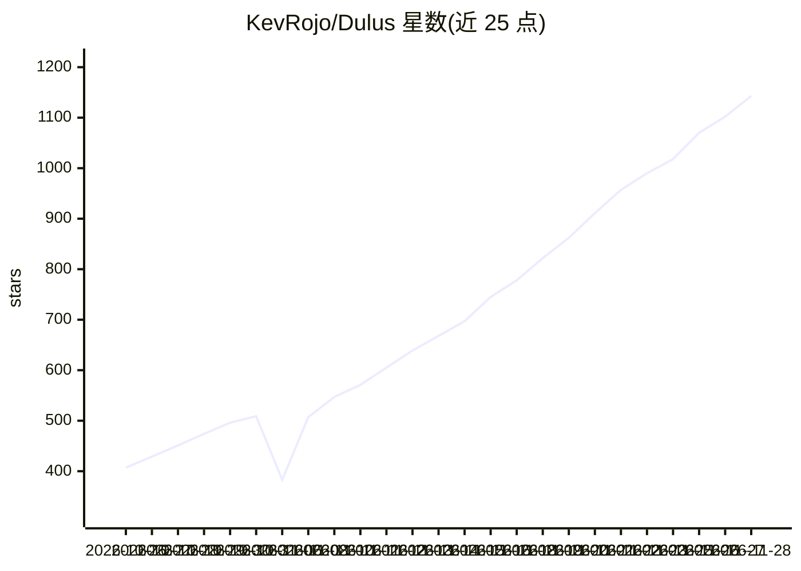

# KevRojo/Dulus

⭐ 1,143 · Python · GPL-3.0 · 推送 2026-11-27 · [GitHub](https://github.com/KevRojo/Dulus) · [官网](https://dulus.ai/) · 个人维护

**面向个人用户的桌面与终端 AI agent，处理文件、shell 与浏览器任务**

开源部分为终端 agent（pip 安装，GPLv3），桌面版为闭源应用，免费层使用用户自备 API key 或本地模型，Operator 订阅提供托管模型额度（Fuel）。功能包括多模型会话中切换（/model）、最多 26 个 agent 的圆桌协作、屏幕操作、语音、Telegram 配对、~1,900 个 MCP 服务器与约 69,000 技能市场、OpenAI 兼容 API 端点。由单人开发者维护，附测试规模与提交统计。

## 筛选速览

| 维度 | 判定 | 备注 |
|---|---|---|
| AI 角色 | `ai-native` | 本体是模型或模型工具 |
| 许可风险 | `viral` | GPL-3.0 |
| 部署形态 | `library` | 以包/库形式分发 |
| 模型依赖 | — | README 未给出锁定关系 |
| 硬件要求 | — | 无带数字的原话,不猜 |
| 安装摩擦 | `low` | 无编译、无系统依赖或容器化 |
| 成熟度 | — | 结构信号不足 |

## 能力要点

- 最多 26 个模型/agent 的 Round Table 协作与共享任务板
- ~1,900 MCP 服务器、~69,000 技能、1,946 插件的内置市场与 Auto-adapt
- 屏幕操作、WebDrive 内置浏览器、实时终端与语音（Astral Voice）
- OpenAI 兼容 API 端点，可用 Fuel 支付

## 适用场景

- 让 agent 读取文件、跑命令、修测试并持续对话
- 在桌面端用自备 API key 或本地模型运行 agent
- 用 Telegram 从手机继续同一会话并审批操作
- 按工作类型安装技能包到独立工作区

## 场景标签

`AI 助手` `浏览器自动化` · 领域:效率与自动化

## 证据(README 行号)

> L36: > Dulus is an AI agent for your desktop and terminal. It works in your files, your shell, your browser and your scr
> L136: ### The Round Table
> L152: **40+ provider integrations** — the major APIs, local runtimes, and Dulus's own hosted models — with one reasoning

## 星数曲线

2026-10-26 407 → 2026-11-28 1,143（+736）

---
*卡片 v1 · prompt 1.4 · 生成 2026-11-28 · 置信度 mid · 依据 README sha `ec63d6b25e91` · [字段定义](../../DATASET.md)*
