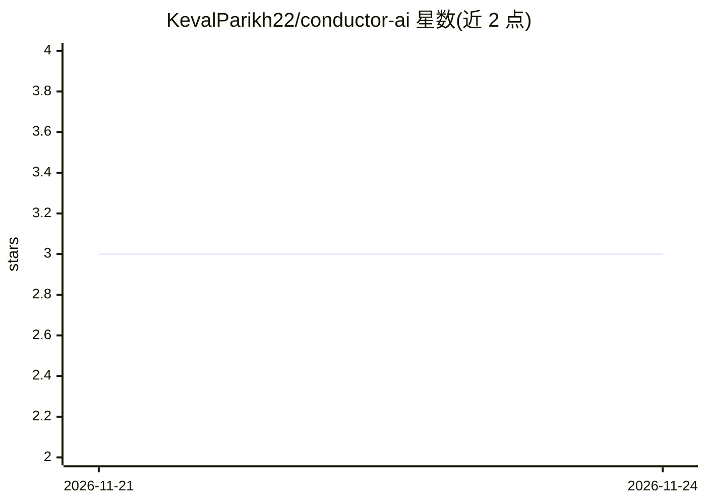

# KevalParikh22/conductor-ai

⭐ 3 · JavaScript · MIT · 推送 2026-11-23 · [GitHub](https://github.com/KevalParikh22/conductor-ai) · [官网](https://github.com/KevalParikh22/conductor-ai#readme) · 个人维护

**为编码 agent 分配免费/低价模型写码的多 LLM 编排器**

conductor-ai 以用户使用的编码 agent（Claude Code、Codex CLI、Antigravity CLI 或 OpenCode）为控制器，负责规划、审查与质量把关，把逐行写码任务委派给其他 agent 或免费/低价 API 模型，配额耗尽时按角色回退链切换下一个提供商。每个任务在独立 git worktree 中运行，写任务后自动跑测试与 lint，并将 worker 报告与 git 实际变更比对。按 npm 包分发（Node 20+），提供 CLI、MCP server 与浏览器设置页，声明零依赖、无遥测，README 标注为 v0.11 公开 alpha、单人维护。

## 筛选速览

| 维度 | 判定 | 备注 |
|---|---|---|
| AI 角色 | `ai-ecosystem` | LLM/agent 周边工具 |
| 许可风险 | `permissive` | MIT |
| 部署形态 | `library` | 以包/库形式分发 |
| 模型依赖 | local-ok | 支持本地模型 |
| 硬件要求 | — | 无带数字的原话,不猜 |
| 安装摩擦 | `low` | 无编译、无系统依赖或容器化 |
| 成熟度 | `idea` | |

## 能力要点

- 配额感知回退：限流时按回退链切换提供商，全失败则控制器自做
- 每个 agent 在独立沙箱/权限规则下运行，API key 不进入其环境
- 任务级路由规则：按文件、任务文本或角色分配提供商
- 每轮记录时间、token 与成本，付费 API 有每日预算上限

## 适用场景

- 用免费/低价模型承担写码以减少主力 agent 配额消耗
- 多任务并行开发时按角色路由到不同提供商
- 为每个编码 agent 限定写入范围与权限

## 场景标签

`多智能体` `编码 Agent` `模型网关` · 领域:Agent 开发

## 证据(README 行号)

> L22: Your best agent's quota runs out fast when it types every line, and its strength is judgement: planning, design and
> L43: - **Quota-aware fallback.** A rate-limited model first falls back to the provider's next model (`fallbackModels`); 

## 星数曲线

2026-11-21 3 → 2026-11-24 3（+0）

---
*卡片 v1 · prompt 1.4 · 生成 2026-11-22 · 置信度 high · 依据 README sha `190604c97e06` · [字段定义](../../DATASET.md)*
