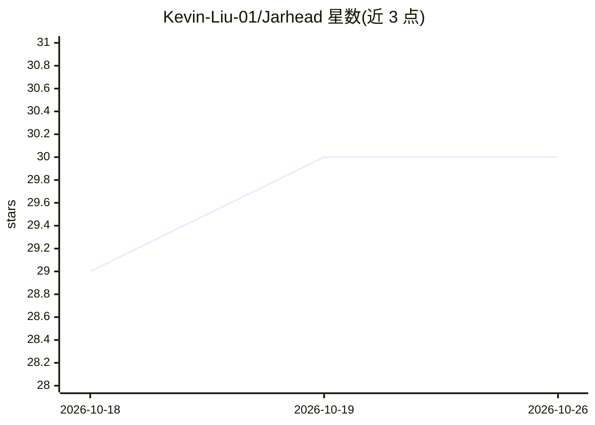

# Kevin-Liu-01/Jarhead

⭐ 30 · TypeScript · MIT · 推送 2026-10-25 · [GitHub](https://github.com/Kevin-Liu-01/Jarhead) · [官网](https://jarhead.kevinliu.studio) · 个人维护

**语音优先的 Mac 助手：用语音让 AI 替你操作电脑**

macOS 桌面语音助手：喊唤醒词、过 Touch ID 后用 GPT-Live-1 语音对话，由 Codex、Claude Code、Anthropic API、OpenAI 兼容 API 或本地模型（Ollama/LM Studio/llama.cpp）作为大脑，通过 Swift 编写的 71 个工具族操作屏幕、鼠标、键盘、浏览器与系统。支持并行线程、策略门控确认、离线反射命令、闹钟自动化与仅追加的操作台账；刘海区显示控制面板。要求 macOS 14+ Apple silicon，需 Xcode 16、Node 24 与 pnpm 10。

## 筛选速览

| 维度 | 判定 | 备注 |
|---|---|---|
| AI 角色 | `ai-native` | 本体是模型或模型工具 |
| 许可风险 | `permissive` | MIT |
| 部署形态 | `library` | 以包/库形式分发 |
| 模型依赖 | local-ok | 支持本地模型 |
| 硬件要求 | — | 无带数字的原话,不猜 |
| 安装摩擦 | `low` | 无编译、无系统依赖或容器化 |
| 成熟度 | — | 结构信号不足 |

## 能力要点

- GPT-Live-1 全双工语音，唤醒词 + Touch ID/Apple Watch/密码解锁
- 71 个工具操作 Mac，大脑可选 Codex/Claude Code/API/本地模型
- 并行线程、策略门控确认与 1.5 秒人工操作优先权
- 每步操作写入仅追加台账（~/.jarhead/ledger/<day>.jsonl）

## 适用场景

- 用语音指挥 Mac 完成点按、输入、浏览与自动化任务
- 同时跑多条任务线程并分别追问/停止
- 在 Console 中查看并接管本机的 Claude Code/Codex 会话

## 场景标签

`GUI 自动化` `语音 Agent` `AI 助手` · 领域:效率与自动化

## 证据(README 行号)

> L10:  A voice-first Mac assistant that uses the computer for you.
> L57: - 🧠 **The brain is a setting.** `codex` (your ChatGPT login, a resident `codex app-server` thread; Jarhead finds th
> L58: - 🖱️ **Uses the Mac.** 71 tools in ten families: computer (screen, mouse, keyboard) · desktop (apps, windows, contr

## 星数曲线

2026-10-18 29 → 2026-10-26 30（+1）

---
*卡片 v1 · prompt 1.4 · 生成 2026-10-26 · 置信度 mid · 依据 README sha `97ededa92cd4` · [字段定义](../../DATASET.md)*
