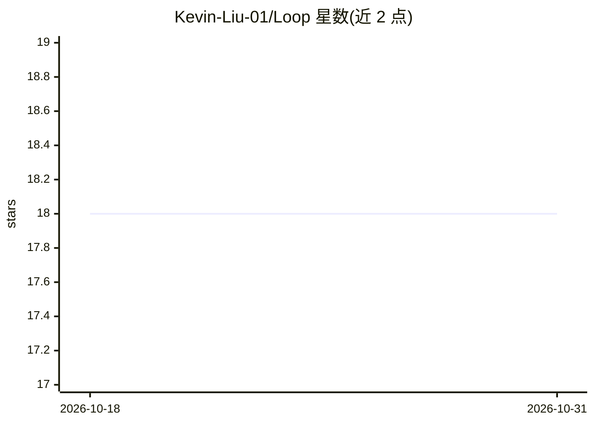

# Kevin-Liu-01/Loop

⭐ 18 · TypeScript · MIT · 推送 2026-10-22 · [GitHub](https://github.com/Kevin-Liu-01/Loop) · [官网](https://loooooop.vercel.app) · 个人维护

**自动追踪信息源并自我更新的 agent 技能运维台**

面向 agent 技能（SKILL.md）的运维平台：用户跟踪技能依赖的外部信息源（RSS/Atom/文档/博客/GitHub 等），系统按日/周定时运行研究型 agent，扫描源、经 Brave Search 网页检索并基于证据改写技能正文，每次刷新保存为不可变版本并附带 diff、日志与来源记录。内置沙箱（Node.js/Python）可对技能运行 agent，支持 MCP 接入。基于 Vercel AI Gateway、Queues、Sandbox 与 Supabase/Clerk/Stripe 构建，付费 Operator 计划解锁无限自动化。

## 筛选速览

| 维度 | 判定 | 备注 |
|---|---|---|
| AI 角色 | `ai-ecosystem` | LLM/agent 周边工具 |
| 许可风险 | `permissive` | MIT |
| 部署形态 | `library` | 以包/库形式分发 |
| 模型依赖 | local-ok | 支持本地模型 |
| 硬件要求 | — | 无带数字的原话,不猜 |
| 安装摩擦 | `low` | 无编译、无系统依赖或容器化 |
| 成熟度 | — | 结构信号不足 |

## 能力要点

- 定时刷新流水线：cron 编排 + 队列 worker 逐技能研究改写
- 每次刷新保存不可变版本，diff、搜索轨迹、日志均可查看
- 目录含 100+ 已验证技能，多个达 v16–v21
- 沙箱中运行 agent（Node.js/Python），可挂接技能与 MCP 服务器

## 适用场景

- 让我的 agent 技能随信息源变化自动更新而非过期失效
- 审查每次技能更新的来源与前后 diff
- 在沙箱里带技能和 MCP 运行 agent 验证效果

## 场景标签

`提示工程` `工作流自动化` · 领域:Agent 开发

## 证据(README 行号)

> L19: Loop started as the tool I wanted instead: an operator desk for agent skills that runs on its own. You track the so
> L45: 2. refreshes tracked skills from external sources and saves each pass as a new version (3 automations free, unlimit
> L152: The Sandbox provisions a secure Vercel Sandbox session. The Agent Studio lets you choose a provider and model (Ver

## 星数曲线

2026-10-18 18 → 2026-10-31 18（+0）

---
*卡片 v1 · prompt 1.4 · 生成 2026-10-29 · 置信度 high · 依据 README sha `9d8efc9c0b6f` · [字段定义](../../DATASET.md)*
