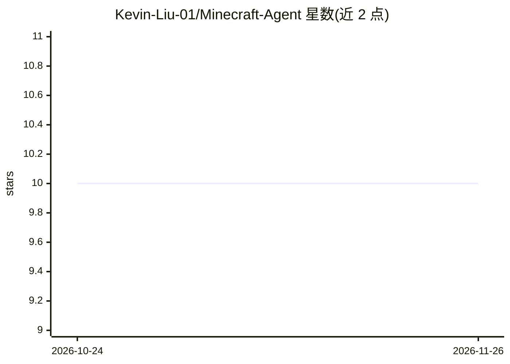

# Kevin-Liu-01/Minecraft-Agent

⭐ 10 · Python · MIT · 推送 2026-06-16 · [GitHub](https://github.com/Kevin-Liu-01/Minecraft-Agent) · 个人维护

**通过自然语言/游戏内聊天控制 Minecraft 机器人的 MCP 服务**

由 Python MCP server 与 Node Mineflayer 桥组成的局域网向 Minecraft 自动化栈：把 60+ 个机器人操作（移动、挖掘、建造、合成、熔炼、战斗等）暴露为 MCP 工具，可通过 Dedalus agent 或游戏内聊天以自然语言指令操控。v2 加入技能库、多步规划、持久世界记忆、自由形状建造、错误重试与创造/生存模式切换，并支持自主生存模式（检查→规划→执行→学习循环）。需要 Minecraft Java 版、Python 3.10+、Node 20+ 与 Dedalus API key；云 agent 响应聊天指令需 ngrok 暴露 MCP server。

## 筛选速览

| 维度 | 判定 | 备注 |
|---|---|---|
| AI 角色 | `ai-native` | 本体是模型或模型工具 |
| 许可风险 | `permissive` | MIT |
| 部署形态 | `None` |  |
| 模型依赖 | — | README 未给出锁定关系 |
| 硬件要求 | — | 无带数字的原话,不猜 |
| 安装摩擦 | `low` | 无编译、无系统依赖或容器化 |
| 成熟度 | — | 结构信号不足 |

## 能力要点

- 60+ 个 Minecraft 操作以 MCP 工具形式暴露
- 游戏内聊天直接输入自然语言指令（挖矿、建造、战斗等）
- 技能库与持久世界记忆跨会话保存复用
- 自主生存模式：检查→规划→执行→学习循环

## 适用场景

- 让 AI 机器人在 LAN 世界里代替完成采集、建造等任务
- 在游戏内聊天用自然语言指挥机器人行动
- 无游戏环境下用模拟模式测试 agent 栈

## 场景标签

`聊天机器人` · 领域:对话与助手

## 证据(README 行号)

> L5: LAN-oriented Minecraft MCP stack: Python MCP server + Node Mineflayer bridge. Control a bot via the Dedalus agent or
> L38: - **Python MCP server** – Exposes 60+ Minecraft bot actions as MCP tools (move, mine, place, attack, craft, chat, p

## 星数曲线

2026-10-24 10 → 2026-11-26 10（+0）

---
*卡片 v1 · prompt 1.4 · 生成 2026-11-20 · 置信度 high · 依据 README sha `6eb60964e39c` · [字段定义](../../DATASET.md)*
