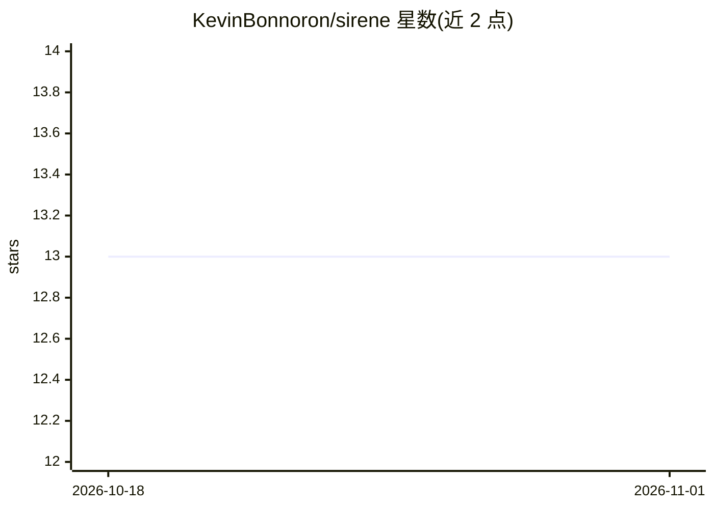

# KevinBonnoron/sirene

⭐ 13 · TypeScript · MIT · 推送 2026-09-25 · [GitHub](https://github.com/KevinBonnoron/sirene) · 个人维护

**自托管多后端文字转语音平台，含语音克隆与 Web UI**

自托管的 TTS 平台，通过单一 Web 界面将请求路由到 Kokoro、Qwen3-TTS、F5-TTS、Piper、CosyVoice、Fish Speech、Chatterbox 等多个后端，支持上传音频样本进行零样本语音克隆，并可在 Web UI 中按需下载与管理 TTS 模型。附带 Whisper 模型的语音转文字功能，通过 SSE 跟踪下载与生成进度。部署形态为两个 Docker 镜像（Go 单二进制负责 Web/API/数据库，另一个负责推理），提供 curl 安装脚本一键安装，MIT 许可。

## 筛选速览

| 维度 | 判定 | 备注 |
|---|---|---|
| AI 角色 | `ai-ecosystem` | LLM/agent 周边工具 |
| 许可风险 | `permissive` | MIT |
| 部署形态 | `library` | 以包/库形式分发 |
| 模型依赖 | — | README 未给出锁定关系 |
| 硬件要求 | — | 无带数字的原话,不猜 |
| 安装摩擦 | `low` | 无编译、无系统依赖或容器化 |
| 成熟度 | — | 结构信号不足 |

## 能力要点

- 单一界面路由到 9 种 TTS 后端，支持语速与音调调节
- 零样本语音克隆（上传音频样本创建自定义音色）
- Web UI 内按需下载与管理 TTS 模型
- Whisper 模型语音转文字与 SSE 实时进度

## 适用场景

- 自建文字转语音服务，统一管理多种 TTS 模型
- 用自己上传的音频样本克隆个性化音色
- 为应用提供可自托管的语音生成 API 与界面

## 场景标签

`语音合成` `语音识别` · 领域:内容生成

## 证据(README 行号)

> L7: Self-hosted multi-backend text-to-speech platform with voice cloning and a modern web UI.
> L31: - **Multi-backend TTS** - Route requests to Kokoro, Qwen3-TTS, F5-TTS, Piper, CosyVoice, Fish Speech, or Chatterbox

## 星数曲线

2026-10-18 13 → 2026-11-01 13（+0）

---
*卡片 v1 · prompt 1.4 · 生成 2026-10-31 · 置信度 mid · 依据 README sha `39e7b62a0585` · [字段定义](../../DATASET.md)*
