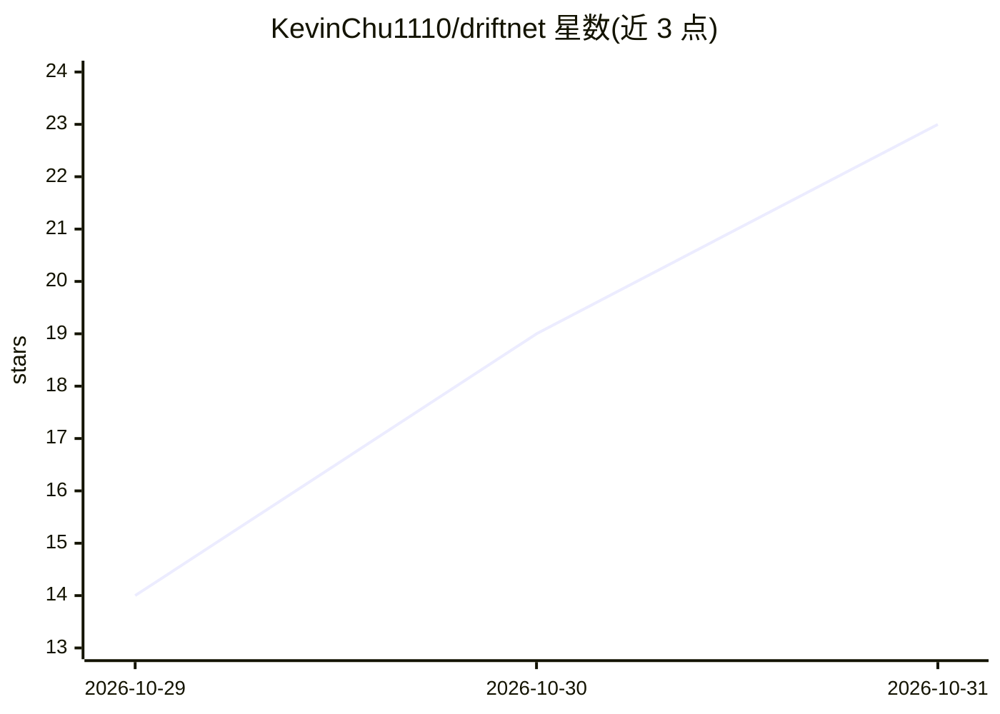

# KevinChu1110/driftnet

⭐ 23 · TypeScript · MIT · 推送 2026-10-30 · [GitHub](https://github.com/KevinChu1110/driftnet) · [官网](https://kevinchu1110.github.io/driftnet/) · 个人维护 · 中文 README

**把聊天里分享的链接自动归类、摘要、可搜索的本地收藏目录**

本地运行的链接收集与整理工具：通过群聊机器人（LINE/Slack/Discord/Telegram）、Chrome 扩展、命令行或 HTTP 接口接收链接，追踪帖子指向的实际项目，将页面裁剪为约 350 token 的大纲后调用模型生成一句话摘要，并按用户文件夹自动归类，存入本地 SQLite 支持全文检索。可接入任意模型或不使用模型（此时链接不分类）。另通过 MCP、/llms.txt、webhook 等方式供 AI agent 读写同一目录。需 Node.js 22.13+。

## 筛选速览

| 维度 | 判定 | 备注 |
|---|---|---|
| AI 角色 | `ai-enhanced` | 去掉 AI 部分产品仍成立 |
| 许可风险 | `permissive` | MIT |
| 部署形态 | `self-host` | docker 或自建部署 |
| 模型依赖 | local-ok | 支持本地模型 |
| 硬件要求 | — | 无带数字的原话,不猜 |
| 安装摩擦 | `low` | 无编译、无系统依赖或容器化 |
| 成熟度 | — | 结构信号不足 |

## 能力要点

- 多入口收链：Discord/Telegram/Slack/LINE 机器人、Chrome 扩展、命令行、HTTP
- 页面裁剪至约 350 token 后再送模型，重复链接不计费
- 可使用任意模型或不使用模型（无模型时链接不分类列出）
- MCP、/llms.txt、/feed.xml 与 webhook 供 agent 读写目录
- 拒绝私网/本地地址，检测 prompt injection 且不传给 agent

## 适用场景

- 把群里分享的文章和仓库收集起来做成可搜索的个人目录
- 让 AI 自动摘要并归类收藏的链接，用思维导图整理文件夹
- 让 Claude Code 等 agent 通过 MCP 读取自己的收藏目录

## 场景标签

`知识库管理` · 领域:知识与检索

## 证据(README 行号)

> L29: in your language, and files it in your own folders, in a local catalogue with full-text search
> L78: - 🧩 **Any model or none, and it stays yours.** An API, your Claude or Google subscription, Ollama, or no model (lin

## 星数曲线

2026-10-29 14 → 2026-10-31 23（+9）

---
*卡片 v1 · prompt 1.4 · 生成 2026-10-30 · 置信度 high · 依据 README sha `9b8f9207abda` · [字段定义](../../DATASET.md)*
