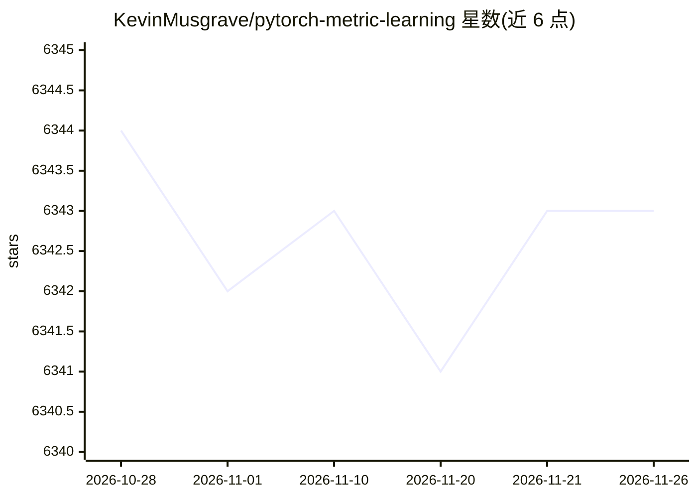

# KevinMusgrave/pytorch-metric-learning

⭐ 6,343 · Python · MIT · 推送 2026-11-21 · [GitHub](https://github.com/KevinMusgrave/pytorch-metric-learning) · [官网](https://kevinmusgrave.github.io/pytorch-metric-learning/) · 个人维护

**PyTorch 度量学习库：训练/评估相似度检索的嵌入模型**

基于 PyTorch 的度量学习库，以可组合组件（损失函数、难例挖掘器、距离、reducer、正则化器）嵌入自定义训练循环，用于检索、聚类、识别及成对/三元组学习任务。核心包仅依赖 PyTorch 与 NumPy，Faiss 检索后端与 scikit-learn 聚类指标以可选扩展提供。面向做嵌入训练与相似度搜索的研究者与开发者，每个组件页面附签名、张量契约与引用论文，另有完整训练/评估示例。

## 筛选速览

| 维度 | 判定 | 备注 |
|---|---|---|
| AI 角色 | `ai-native` | 本体是模型或模型工具 |
| 许可风险 | `permissive` | MIT |
| 部署形态 | `library` | 以包/库形式分发 |
| 模型依赖 | — | README 未给出锁定关系 |
| 硬件要求 | — | 无带数字的原话,不猜 |
| 安装摩擦 | `low` | 无编译、无系统依赖或容器化 |
| 成熟度 | — | 结构信号不足 |

## 能力要点

- 可组合的损失/挖掘器/距离/reducer 组件体系
- 对比损失等成对与三元组损失实现
- 可选 Faiss 检索后端与 NMI/AMI 聚类指标
- 组件页面附带论文引用与完整训练评估示例

## 适用场景

- 训练图像检索或聚类的嵌入模型
- 在自定义训练循环中做难例挖掘与对比学习
- 自监督学习场景下评估嵌入质量

## 场景标签

 · 领域:机器学习/度量学习库

## 证据(README 行号)

> L3: Train embedding models with composable PyTorch losses, hard-example miners,
> L5: retrieval, clustering, recognition, or learning from pairs and triplets.

## 星数曲线

2026-10-28 6,344 → 2026-11-26 6,343（-1）

---
*卡片 v1 · prompt 1.4 · 生成 2026-11-22 · 置信度 high · 依据 README sha `5ad4731c9c59` · [字段定义](../../DATASET.md)*
