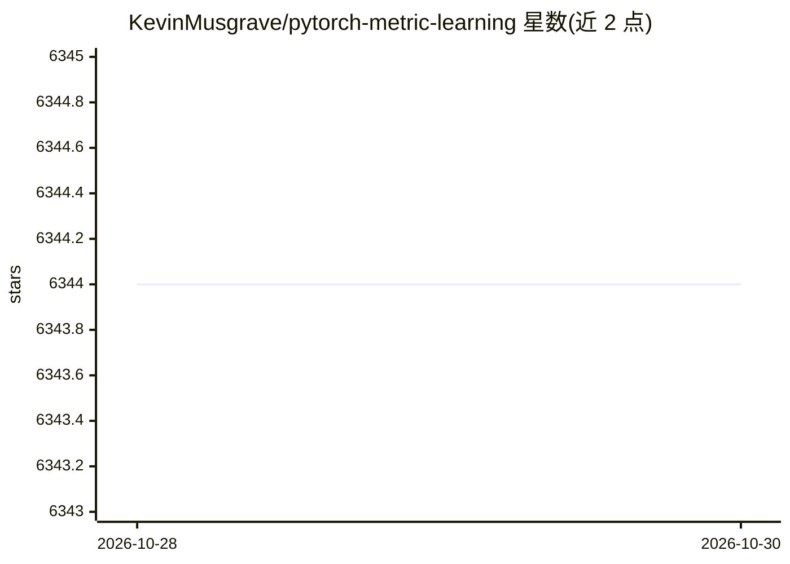

# KevinMusgrave/pytorch-metric-learning

⭐ 6,344 · Python · MIT · 推送 2026-10-29 · [GitHub](https://github.com/KevinMusgrave/pytorch-metric-learning) · [官网](https://kevinmusgrave.github.io/pytorch-metric-learning/) · 个人维护

**面向开发者的 PyTorch 深度度量学习模块化库**

基于 PyTorch 的深度度量学习库，包含 9 个可独立使用的模块：损失函数、难样本挖掘器、距离、归约器、正则器、训练器、测试器、精度计算器和数据集模块。损失函数可在用户现有训练循环中嵌入，支持三元组/成对损失的自动转换，提供 SelfSupervisedLoss 包装器用于自监督学习，及 CrossBatchMemory 实现 MoCo 风格动量队列。附带 Datasets 模块可下载 CUB200、Cars196 等常用数据集，并提供 Google Colab 示例笔记本。通过 pip/conda 安装。

## 筛选速览

| 维度 | 判定 | 备注 |
|---|---|---|
| AI 角色 | `ai-native` | 本体是模型或模型工具 |
| 许可风险 | `permissive` | MIT |
| 部署形态 | `library` | 以包/库形式分发 |
| 模型依赖 | — | README 未给出锁定关系 |
| 硬件要求 | — | 无带数字的原话,不猜 |
| 安装摩擦 | `low` | 无编译、无系统依赖或容器化 |
| 成熟度 | — | 结构信号不足 |

## 能力要点

- 9 个可独立组合的模块（losses/miners/trainers/testers 等）
- 损失可由距离、归约器、正则器自定义
- SelfSupervisedLoss 包装器与 CrossBatchMemory 支持自监督学习
- Datasets 模块提供 CUB200/Cars196 等常用数据集下载

## 适用场景

- 在图像检索/人脸识别等任务中为现有训练循环加入度量学习损失
- 自监督学习场景下使用任意 tuple 损失与挖掘器
- 直接计算嵌入空间精度并跑完整训练/测试流程

## 场景标签

 · 领域:机器学习/计算机视觉

## 证据(README 行号)

> L37: This library contains 9 modules, each of which can be used independently within your existing codebase, or combined
> L44: Let’s initialize a plain TripletMarginLoss:

## 星数曲线

2026-10-28 6,344 → 2026-10-30 6,344（+0）

---
*卡片 v1 · prompt 1.4 · 生成 2026-10-28 · 置信度 high · 依据 README sha `e2a03b8094e5` · [字段定义](../../DATASET.md)*
