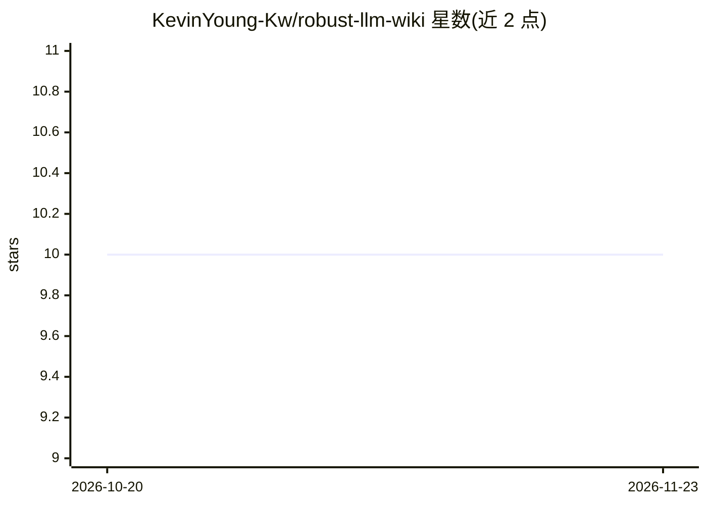

# KevinYoung-Kw/robust-llm-wiki

⭐ 10 · Apache-2.0 · 推送 2026-04-18 · [GitHub](https://github.com/KevinYoung-Kw/robust-llm-wiki) · 个人维护 · 中文 README

**面向 AI 维护者的 LLM Wiki 长期维护规则框架**

以文档为中心的 LLM-Wiki 控制面框架，不发布具体 Wiki 内容，而发布维护规则：从两个长期运行的 LLM-Wiki（约 3,093 个 Markdown 文件、17,780 条 wikilinks）中提炼可复用的 ingest/query/lint 循环、架构边界、agent 运行时防漂移与知识晋升规则。仓库分 research/（证据与失败模式）与 schema/（规范与操作策略）两部分，不含固定实现，由下游 Wiki 提供数据面；README 为中英双语，代码 Apache-2.0、文档 CC BY 4.0。

## 筛选速览

| 维度 | 判定 | 备注 |
|---|---|---|
| AI 角色 | `ai-knowledge` | 知识聚合/清单类 |
| 许可风险 | `permissive` | Apache-2.0 |
| 部署形态 | `None` |  |
| 模型依赖 | — | README 未给出锁定关系 |
| 硬件要求 | — | 无带数字的原话,不猜 |
| 安装摩擦 | `low` | 无编译、无系统依赖或容器化 |
| 成熟度 | — | 结构信号不足 |

## 能力要点

- 从两个匿名化生产 Wiki 提炼的可复用维护规则与失败模式记录
- 定义 ingest→query→lint 维护循环与知识晋升契约
- 发布控制面（规则/规范），数据面由各私有 Wiki 自持
- 提供 CLAUDE.md / AGENTS.md / GEMINI.md 生成路径与双语规范文档

## 适用场景

- 将框架适配到已有的 LLM-Wiki 以维持长期可维护性
- 依据操作指南为新 Wiki 生成 agent 运行策略文件
- 参考 research/ 中的失败模式设计自己的维护流程

## 场景标签

`知识库管理` · 领域:知识与检索

## 证据(README 行号)

> L12: Robust LLM-Wiki is a document-centered control-plane for long-term Wiki maintenance with AI.
> L14: This repository does not publish a private wiki. It publishes the framework for keeping one stable over time: how t
> L80: 3. runbooks for how agents should ingest, query, lint, hand off, and promote knowledge.

## 星数曲线

2026-10-20 10 → 2026-11-23 10（+0）

---
*卡片 v1 · prompt 1.4 · 生成 2026-11-20 · 置信度 high · 依据 README sha `69e0094c7d97` · [字段定义](../../DATASET.md)*
