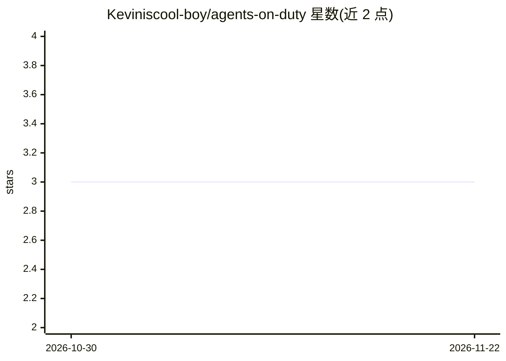

# Keviniscool-boy/agents-on-duty

⭐ 3 · Python · MIT · 推送 2026-11-10 · [GitHub](https://github.com/Keviniscool-boy/agents-on-duty) · 个人维护 · 中文 README

**LangGraph 多 Agent 客服学习项目：知识问答、售后受理与人工接管**

可运行的客服 Agent 学习项目，覆盖知识库 RAG 问答（FAISS 混合检索、拒答转人工）、演示订单查询、退款申请受理、人工客服工作台与管理员工作区。机制上采用 Supervisor 意图路由、合规规则先行+LLM 补充的检查回路、Redis/MySQL/进程内三层记忆降级、MCP 工具调用失败时的本地备用工具，以及 SSE 进度展示与审计日志。数据为模拟，README 明示不可直接用于生产。

## 筛选速览

| 维度 | 判定 | 备注 |
|---|---|---|
| AI 角色 | `ai-native` | 本体是模型或模型工具 |
| 许可风险 | `permissive` | MIT |
| 部署形态 | `self-host` | docker 或自建部署 |
| 模型依赖 | — | README 未给出锁定关系 |
| 硬件要求 | — | 无带数字的原话,不猜 |
| 安装摩擦 | `low` | 无编译、无系统依赖或容器化 |
| 成熟度 | — | 结构信号不足 |

## 能力要点

- Supervisor 分流 + 合规修复回路（规则先行、LLM 补充、重写兜底）
- 人工接管：确定性转人工关键词、流程暂停恢复、客服工作台审核
- 三层记忆（对话/工作上下文/知识库）与故障降级链
- Docker Compose 一键部署 + 端到端评测与压测脚本

## 适用场景

- 学习 Agent 编排、人工接管与故障恢复的实现方式
- 搭建带人工审核环节的售后/客服演示系统
- 参考其权限矩阵、审计与合规检查的设计取舍

## 场景标签

`多智能体` `RAG` `聊天机器人` · 领域:Agent 开发

## 证据(README 行号)

> L16: Agents on Duty 是一个可运行的客服 Agent 学习项目。它可以回答知识库问题、查询演示订单并受理退款申请；遇到需要人工判断的售后请求时，流程会暂停，交给客服审核，再根据审核结果继续处理。
> L33: - **知识库问答** —— 售后/会员/物流等政策按版本、生效日期和发布状态管理；向量+关键词混合检索并展示来源片段，检索不到或置信度不足时拒答并建议转人工。
> L44: > 需要 Docker、一个 OpenAI 兼容的聊天模型，以及一个 embedding 服务——配置 `DASHSCOPE_API_KEY` 走阿里云原生接口，或留空复用 `OPENAI_BASE_URL` 走任何 OpenAI

## 星数曲线

2026-10-30 3 → 2026-11-22 3（+0）

---
*卡片 v1 · prompt 1.4 · 生成 2026-11-22 · 置信度 high · 依据 README sha `b0204aa6a13b` · [字段定义](../../DATASET.md)*
