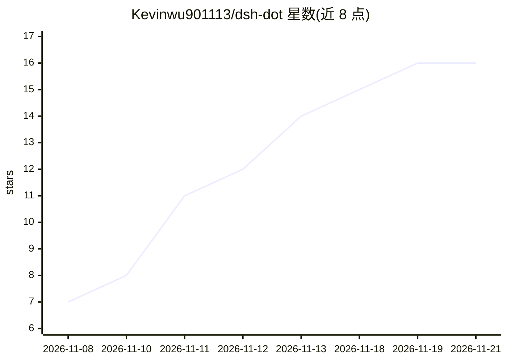

# Kevinwu901113/dsh-dot

⭐ 16 · JavaScript · MIT · 推送 2026-11-20 · [GitHub](https://github.com/Kevinwu901113/dsh-dot) · 个人维护 · 中文 README

**给 DeepSeek Harness 装一个住自己手机的有记忆角色插件**

dsh-dot 是 DeepSeek Harness（dsh）的插件：在指定会话中替换系统开场白，注入人设、记忆与幕间生活记录，使 agent 成为持续陪伴角色。记忆机制为原话库加三栏笔记，本机 multilingual-e5-small 与 bge-reranker-base 召回，15 万 token 交班、每日日记。附带给角色配备插件自建 Android 模拟器（约 2 GB 下载）、microVM 电脑与 QQ 接入（OneBot 11）。有后果动作走审批，全量可审计。需 dsh ≥ 0.2.1 与硬件虚拟化。

## 筛选速览

| 维度 | 判定 | 备注 |
|---|---|---|
| AI 角色 | `ai-native` | 本体是模型或模型工具 |
| 许可风险 | `permissive` | MIT |
| 部署形态 | `None` |  |
| 模型依赖 | — | README 未给出锁定关系 |
| 硬件要求 | — | 无带数字的原话,不猜 |
| 安装摩擦 | `low` | 无编译、无系统依赖或容器化 |
| 成熟度 | — | 结构信号不足 |

## 能力要点

- 人设 + 向量/BM25 召回记忆 + 15 万 token 交班 + 每日日记
- 自动建 Android 模拟器，任何 App 通知可唤醒角色
- 幕间独立生活、每周成长回顾，主动联系需过四道闸
- microVM 电脑 + NapCat/SnowLuma QQ 接入，动作走审批并可审计

## 适用场景

- 让 dsh 成为一个记得我、有自己生活的角色陪我聊天
- 角色通过自己的 QQ 号和手机在我不在时也过日子
- 只要给 dsh 一部手机和电脑当工具（关掉角色组件）

## 场景标签

`Agent 记忆` `聊天机器人` · 领域:Agent 开发

## 证据(README 行号)

> L3: **让你的 DeepSeek Harness 成为 dot · 一个有人设、有记忆、自己过日子的角色**
> L25: dsh 负责跑对话、调工具、接 IM；dsh-dot 决定**这段对话里的人是谁**。在她的会话里（`~/dot` 工作区和 IM 机器人开的会话），dsh 自带的「You are an AI agent」开场白被拿掉，换成她的人

## 星数曲线

2026-11-08 7 → 2026-11-21 16（+9）

---
*卡片 v1 · prompt 1.4 · 生成 2026-11-18 · 置信度 high · 依据 README sha `9be2ac8a4295` · [字段定义](../../DATASET.md)*
