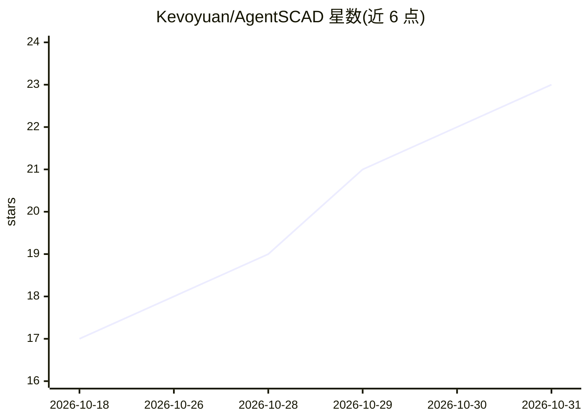

# Kevoyuan/AgentSCAD

⭐ 23 · TypeScript · MIT · 推送 2026-10-28 · [GitHub](https://github.com/Kevoyuan/AgentSCAD) · [官网](https://agentscad.vercel.app) · 个人维护 · 中文 README

**自然语言生成可编辑 OpenSCAD 模型的本地 CAD 工作台**

基于 Next.js 的本地优先 AI 参数化 CAD 工作台：输入一句自然语言，生成可编辑的 OpenSCAD 代码、实时 3D 渲染几何、STL 导出件，并用 Python/Trimesh 对流形性、最小壁厚、外边界做确定性校验。生成前经本地别名索引做词法检索注入示例，机械歧义时暂停供用户决策；SQLite 本地存储任务与结果账本。支持 DeepSeek、OpenAI、Anthropic、Gemini 等预设或本地模型，密钥存于本地。可用 Bun 或 Docker Compose 运行。

## 筛选速览

| 维度 | 判定 | 备注 |
|---|---|---|
| AI 角色 | `ai-native` | 本体是模型或模型工具 |
| 许可风险 | `permissive` | MIT |
| 部署形态 | `self-host` | docker 或自建部署 |
| 模型依赖 | — | README 未给出锁定关系 |
| 硬件要求 | — | 无带数字的原话,不猜 |
| 安装摩擦 | `low` | 无编译、无系统依赖或容器化 |
| 成熟度 | — | 结构信号不足 |

## 能力要点

- 自然语言→OpenSCAD 代码→3D 几何→STL 的生成链路
- Trimesh 确定性物理校验（流形、壁厚、边界）
- 词法别名索引检索，无嵌入索引；歧义时暂停供用户决策
- SQLite 本地持久化与 append-only 结果账本

## 适用场景

- 用一句话生成可调参的 3D 打印零件模型
- 在浏览器中边对话边修改 CAD 参数并导出 STL
- 对生成件做壁厚与流形等可打印性检查

## 场景标签

`代码生成` · 领域:编码与开发

## 证据(README 行号)

> L15: AgentSCAD is a **local-first, open-source AI parametric CAD workspace**. Built like a precision metrology instrumen
> L73: 3. **Renders Real Geometry**: Invokes OpenSCAD (Native CLI or pinned WebAssembly) to generate mesh & STL;

## 星数曲线

2026-10-18 17 → 2026-10-31 23（+6）

---
*卡片 v1 · prompt 1.4 · 生成 2026-10-28 · 置信度 high · 依据 README sha `e709307dd948` · [字段定义](../../DATASET.md)*
