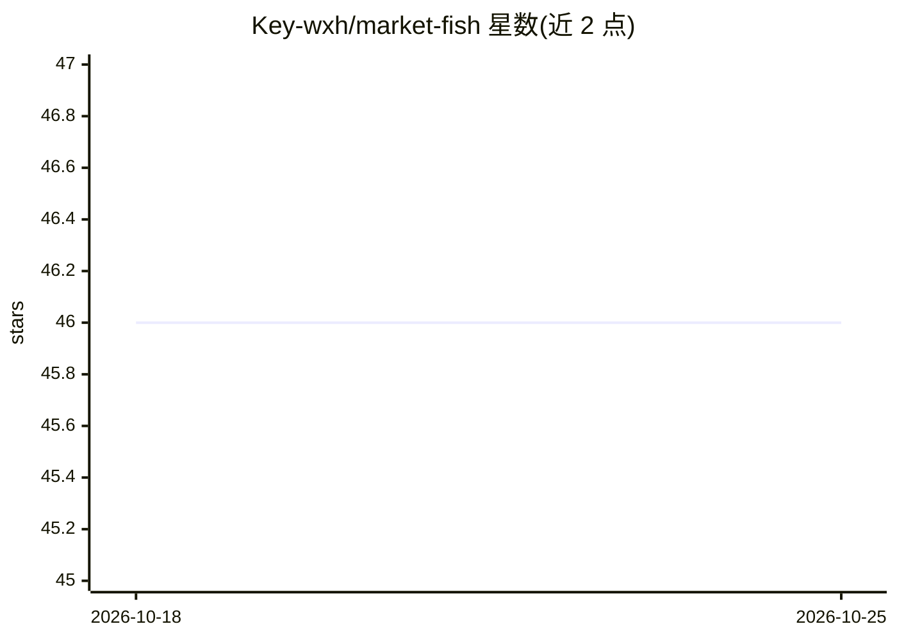

# Key-wxh/market-fish

⭐ 46 · Python · MIT · 推送 2026-07-07 · [GitHub](https://github.com/Key-wxh/market-fish) · 个人维护 · 中文 README

**多智能体市场模拟引擎：用 128+ AI 消费者模拟验证产品**

MarketFish 是一个多智能体市场模拟引擎，面向需要在发布前验证产品方向的创业者/团队。它以静态 JSON 种子数据为输入，经本体提取、知识图谱、智能体工厂（128 个异质 AI 消费者，6 类 LLM）、30 轮模拟与报告生成的 5 阶段流水线，输出购买者画像、生存分数、最优价格等证据。实现 6 篇论文机制（记忆、时间引擎、推荐系统、BDI 认知循环、压力模型、RAG 接地），支持 11 个 LLM 提供商，至少需要一个 API key（README 称 DeepSeek 最便宜）。以 Streamlit 应用与 CLI 两种方式运行，MIT 许可。

## 筛选速览

| 维度 | 判定 | 备注 |
|---|---|---|
| AI 角色 | `ai-native` | 本体是模型或模型工具 |
| 许可风险 | `permissive` | MIT |
| 部署形态 | `library` | 以包/库形式分发 |
| 模型依赖 | locked-api |  |
| 硬件要求 | — | 无带数字的原话,不猜 |
| 安装摩擦 | `low` | 无编译、无系统依赖或容器化 |
| 成熟度 | — | 结构信号不足 |

## 能力要点

- 128+ 异质 AI 消费者、30 轮购买决策模拟
- 实现 6 篇论文模块（Generative Agents、OASIS、TwinMarket 等）
- 支持 11 个 LLM 提供商（中国 6 家 + 全球 5 家）
- 三种模式：Explore 发现方向 / Validate 验证想法 / Hybrid 同场对比竞品

## 适用场景

- 产品发布前模拟 AI 消费者购买行为验证想法
- 获取买家画像与最优定价建议
- 将自己的产品想法与 AI 竞品放入同一沙盒对比

## 场景标签

`多智能体` · 领域:Agent 开发

## 证据(README 行号)

> L13: MarketFish is a **multi-agent market simulation engine**. Instead of asking one LLM "will this product succeed?", i
> L49:   4. Simulation — 30 rounds: decisions, coupling, RL, memory
> L69: |✅ **Validate**|Your product idea|Survival score, buyer profiles, optimal price|

## 星数曲线

2026-10-18 46 → 2026-10-25 46（+0）

---
*卡片 v1 · prompt 1.4 · 生成 2026-10-25 · 置信度 mid · 依据 README sha `5384503d66cd` · [字段定义](../../DATASET.md)*
