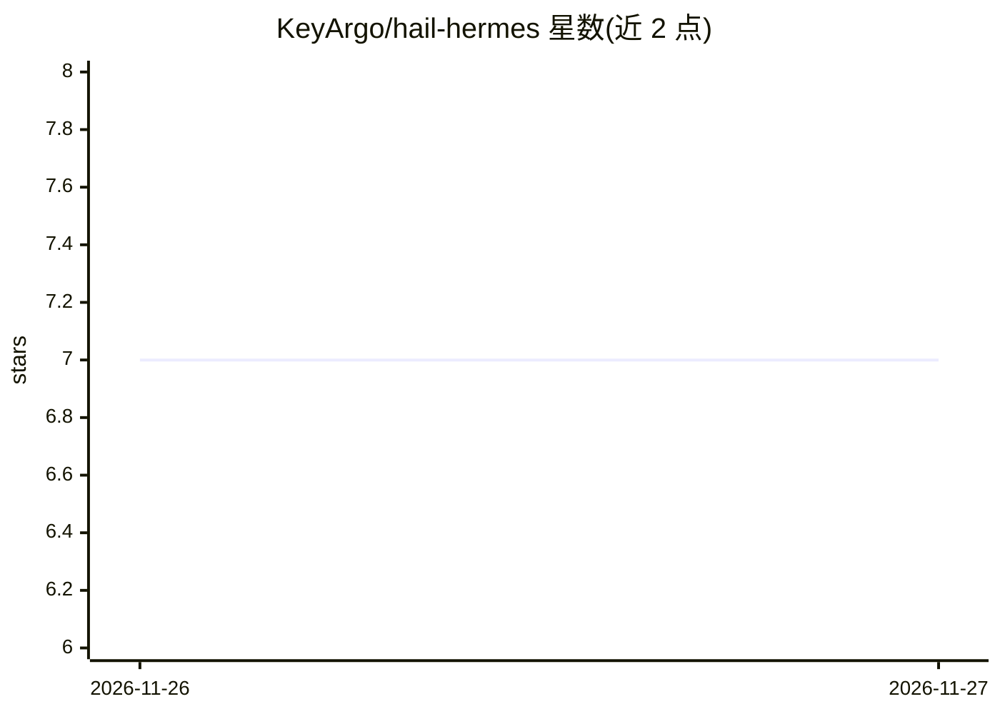

# KeyArgo/hail-hermes

⭐ 7 · Python · MIT · 推送 2026-11-13 · [GitHub](https://github.com/KeyArgo/hail-hermes) · 个人维护

**给自托管 Hermes agent 加语音界面的插件，支持手表配对**

Hermes Agent 插件，包含 hub、桌面面板与手机/手表客户端，为自托管 agent 提供语音朗读、表情动画、主动提醒与设备传感器工具。面板是产品主体，无需手表即可运行；Wear OS 手表通过四位配对码在同 Wi-Fi 下连接。语音依赖 Hermes 内部 TTS/转写工具（无公开插件 API），模型可在 Hermes 订阅、LM Studio、Ollama、vLLM 间实时切换。安装走 hermes plugins 命令，需 ffmpeg 支持语音。

## 筛选速览

| 维度 | 判定 | 备注 |
|---|---|---|
| AI 角色 | `ai-native` | 本体是模型或模型工具 |
| 许可风险 | `permissive` | MIT |
| 部署形态 | `None` |  |
| 模型依赖 | local-ok | 支持本地模型 |
| 硬件要求 | — | 无带数字的原话,不猜 |
| 安装摩擦 | `medium` | 含编译或系统依赖之一 |
| 成熟度 | — | 结构信号不足 |

## 能力要点

- 桌面面板含语音对话、会话记录、人设模板与表情脸，无需硬件
- 手表推送式主动提醒与会话续接（"继续周二的项目"解析到真实文件夹）
- 支持 Hermes 订阅、LM Studio、Ollama、vLLM 模型实时切换
- 373 项测试与无硬件模拟器、headless 测试、静态分析门禁

## 适用场景

- 给自己的 Hermes agent 配上语音与动画界面
- 在 Wear OS 手表上按住说话与 agent 对话
- 用本地模型（Ollama/LM Studio）驱动语音助手

## 场景标签

`语音 Agent` · 领域:对话与助手

## 证据(README 行号)

> L14: Hail Hermes is a Hermes Agent plugin: a hub, a desktop panel, and phone/watch clients, so your
> L40: - **Any model, including local.** Hermes subscription, LM Studio, Ollama, vLLM — switch live, and the

## 星数曲线

2026-11-26 7 → 2026-11-27 7（+0）

---
*卡片 v1 · prompt 1.4 · 生成 2026-11-26 · 置信度 high · 依据 README sha `8f213f3f099b` · [字段定义](../../DATASET.md)*
