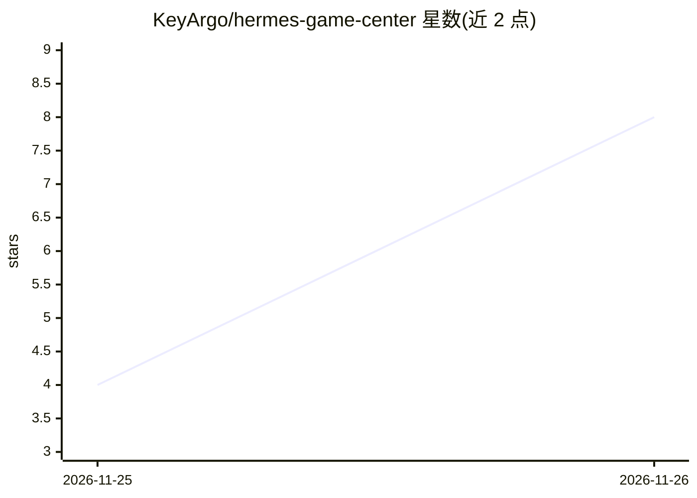

# KeyArgo/hermes-game-center

⭐ 8 · Python · MIT · 推送 2026-11-24 · [GitHub](https://github.com/KeyArgo/hermes-game-center) · 个人维护

**Hermes Agent 桌游/棋牌插件：18 种游戏与拒绝非法着法的裁判**

Hermes Agent 插件，提供 11 种 Play 棋牌游戏（国际象棋、围棋、跳棋、五子棋、海战等）、2 个非棋盘游戏与 4 个谈话桌游戏，每种游戏自带规则引擎。关键机制是模型提议着法、 referee 裁决：非法着法被以一句话拒绝并记录在局谱中。本地内置玩家离线可玩，可选将自身 Hermes 模型设为对手座位，在线大厅默认关闭。通过 hermes plugins install 安装，附 Desktop 图形棋盘、教学与提示功能及积分系统。

## 筛选速览

| 维度 | 判定 | 备注 |
|---|---|---|
| AI 角色 | `ai-enhanced` | 去掉 AI 部分产品仍成立 |
| 许可风险 | `permissive` | MIT |
| 部署形态 | `None` |  |
| 模型依赖 | — | README 未给出锁定关系 |
| 硬件要求 | — | 无带数字的原话,不猜 |
| 安装摩擦 | `low` | 无编译、无系统依赖或容器化 |
| 成熟度 | — | 结构信号不足 |

## 能力要点

- 模型提议、规则引擎裁决：非法着法被公开拒绝并记录在局谱
- 11 种 Play 游戏 + 4 个谈话桌游戏（Mafia、Liar's Dice 等），各自带规则引擎
- 可将任意 provider 的 Hermes 模型设为对手座位，每次着法一次模型调用
- 本地离线运行，在线大厅默认关闭

## 适用场景

- 在 Hermes Agent 里和内置玩家下国际象棋、围棋等棋牌
- 让自己的模型作为对手座位对弈并查看其思考过程
- 在 Desktop 图形棋盘上点击走子
- 通过教学内容学习各游戏的走法

## 场景标签

`AI 助手` · 领域:对话与助手

## 证据(README 行号)

> L4: Eighteen games Hermes can actually play — and a referee that refuses an illegal move out loud. The model proposes th
> L14: That puts the plugin in `~/.hermes/plugins/hermes-gameshelf/` and copies the Games page into the Desktop app from t
> L111: **Play the computer** (`/games allow-ai <game> black=local`) is you agreeing to face the built-in player. A model 

## 星数曲线

2026-11-25 4 → 2026-11-26 8（+4）

---
*卡片 v1 · prompt 1.4 · 生成 2026-11-24 · 置信度 high · 依据 README sha `62f597ff58a8` · [字段定义](../../DATASET.md)*
